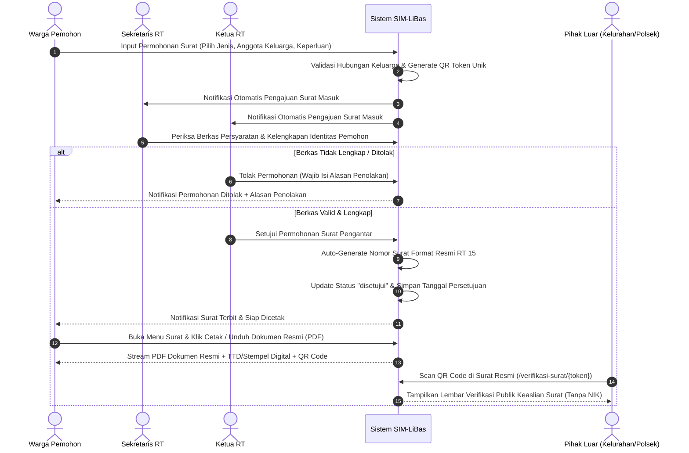
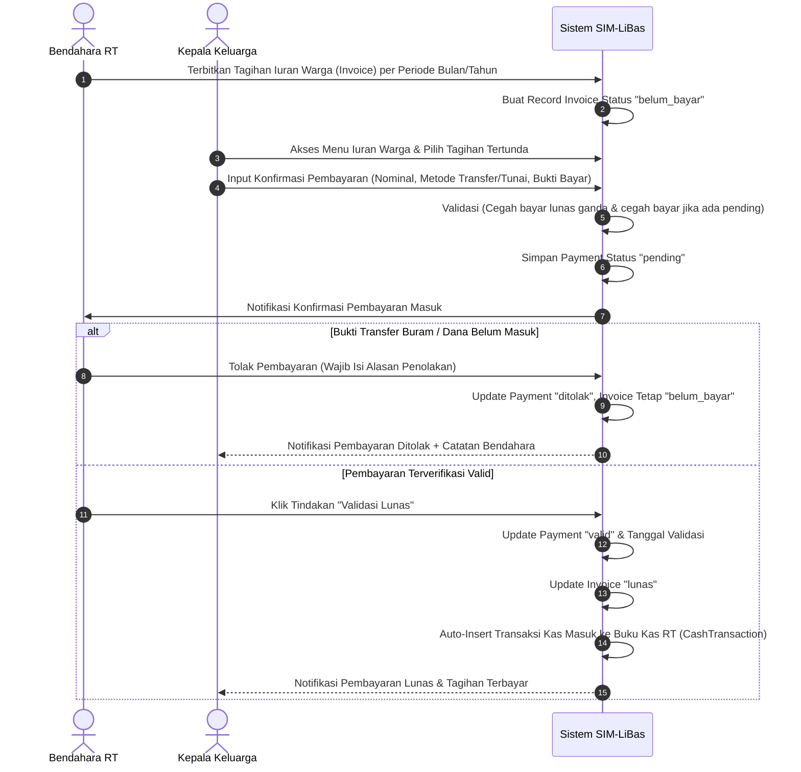
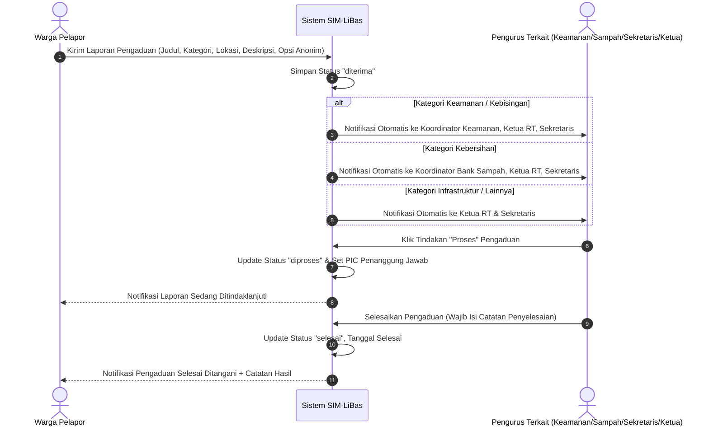
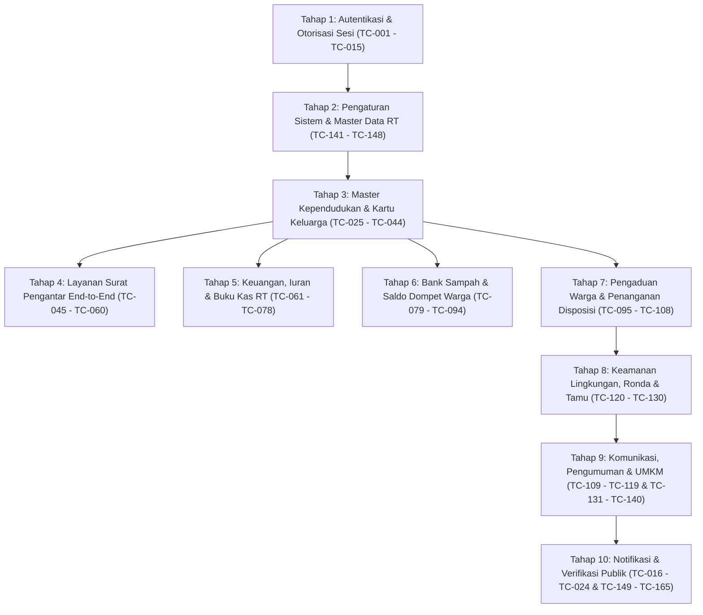

# DOKUMEN RENCANA PENGUJIAN MANUAL & AUDIT PROSES BISNIS SISTEM SIM-LiBas
**Sistem Informasi Manajemen Lingkungan Berbasis Aspirasi & Swadaya (SIM-LiBas)**
**Wilayah Implementasi:** RT 15 Kelurahan Pematang Sulur, Kecamatan Telanaipura, Kota Jambi

---

## DAFTAR ISI
1. [Bagian 1 — Peta Sistem & Audit Proses Bisnis Aktual](#bagian-1--peta-sistem--audit-proses-bisnis-aktual)
   - 1.1 Arsitektur & Teknologi Sistem
   - 1.2 Identifikasi Seluruh Role & Matriks Hak Akses Aktual
   - 1.3 Alur Proses Bisnis Inti & Lifecycle Data
   - 1.4 Audit Route, Middleware & Otorisasi Endpoint
   - 1.5 Temuan Audit Kode Sumber & Deviasi Alur Bisnis
2. [Bagian 2 — Matriks Pengujian Manual Terukur](#bagian-2--matriks-pengujian-manual-terukur)
   - Modul 1: Autentikasi, Akun & Pengelolaan Sesi (TC-001 s/d TC-015)
   - Modul 2: Portal Publik & Verifikasi Dokumen (TC-016 s/d TC-024)
   - Modul 3: Manajemen Kependudukan & Kartu Keluarga (TC-025 s/d TC-044)
   - Modul 4: Layanan Surat Pengantar RT (TC-045 s/d TC-060)
   - Modul 5: Keuangan, Iuran Warga & Kas RT (TC-061 s/d TC-078)
   - Modul 6: Bank Sampah Digital Pinang Masak Lestari (TC-079 s/d TC-094)
   - Modul 7: Pengaduan & Aspirasi Warga (TC-095 s/d TC-108)
   - Modul 8: Komunikasi Warga, Pengumuman & Agenda (TC-109 s/d TC-119)
   - Modul 9: Keamanan Lingkungan, Ronda & Lapor Tamu (TC-120 s/d TC-130)
   - Modul 10: UMKM Warga & Katalog Produk (TC-131 s/d TC-140)
   - Modul 11: Pengaturan Sistem Wilayah & Master Data (TC-141 s/d TC-148)
   - Modul 12: Notifikasi Terpadu Multi-Role & Cross-Role Security (TC-149 s/d TC-165)
3. [Bagian 3 — Rekapitulasi Skenario Pengujian](#bagian-3--rekapitulasi-skenario-pengujian)
4. [Bagian 4 — Checklist Pelaksanaan Pengujian Manual](#bagian-4--checklist-pelaksanaan-pengujian-manual)

---

# BAGIAN 1 — PETA SISTEM & AUDIT PROSES BISNIS AKTUAL

### 1.1 Arsitektur & Teknologi Sistem
Berdasarkan audit langsung pada kode sumber SIM-LiBas:
- **Framework Utama:** Laravel 12 (PHP 8.2+) dengan arsitektur MVC.
- **Panel Pengurus:** Filament v3/v5 (`/admin`) dengan widget analitik kustom (`StatsOverview`), multi-role dynamic dashboard, dan custom Livewire views.
- **Portal Layanan Mandiri Warga:** Antarmuka responsif Blade kustom dengan Tailwind CSS (`/warga/...`).
- **Portal Publik Warga:** Antarmuka informatif profil kampung digital, direktori layanan, katalog UMKM, bank sampah, dan verifikasi surat berbasis QR code.
- **Manajemen Hak Akses:** Spatie Laravel-Permission (Role & Permission berbasis tabel database dan sinkronisasi guard `web`).
- **Audit & Keamanan Data:** Spatie Activitylog untuk pencatatan riwayat perubahan data, hashing NIK menggunakan algoritma SHA-256 (`nik_hash`) sesuai kepatuhan UU No. 27 Tahun 2022 tentang Pelindungan Data Pribadi (UU PDP).
- **Generator Dokumen Resmi:** Barryvdh Laravel-DomPDF dan SimpleSoftwareIO Simple-QRCode untuk penerbitan surat pengantar ber-QR code sah.

---

### 1.2 Identifikasi Seluruh Role & Matriks Hak Akses Aktual

Terdapat **9 Role/Aktor Terdaftar** di dalam sistem (berdasarkan `RoleAndPermissionSeeder.php` dan `User.php`), ditambah **1 Aktor Publik**:

| No | Role / Aktor | Guard / Panel | Hak Akses Utama Berdasarkan Kode Sumber |
|:---:|---|---|---|
| 1 | **Publik / Tamu** | Web (Tanpa Login) | Melihat profil RT, direktori layanan warga, katalog UMKM terverifikasi, statistik bank sampah, kontak RT, dan verifikasi keabsahan surat pengantar melalui token QR Code. |
| 2 | **Warga (Kepala Keluarga)** | Web (`/warga`) | Akses dashboard warga, melihat seluruh anggota KK, edit profil/telepon/email/password, mengajukan surat untuk diri sendiri & seluruh anggota KK, upload bukti bayar iuran KK, kirim pengaduan, lapor tamu, daftarkan UMKM keluarga. |
| 3 | **Warga (Anggota Mandiri)** | Web (`/warga`) | Akses dashboard warga, melihat data KK, edit akun pribadi. **Aturan Bisnis:** Hanya diizinkan mengajukan surat pengantar atas nama dirinya sendiri (dilarang mengajukan atas nama anggota keluarga lain). |
| 4 | **Ketua RT** | Filament (`/admin`) & Web | Mengelola seluruh operasional RT: persetujuan/penolakan surat pengantar resmi, disposisi dan penanganan pengaduan warga, monitoring buku kas RT, moderasi etalase UMKM, pemantauan jadwal ronda & tamu, manajemen kependudukan, pengumuman & agenda. |
| 5 | **Sekretaris RT** | Filament (`/admin`) | Pengelolaan administrasi kependudukan (Input KK & anggota, mutasi warga, ekspor data CSV), pemeriksaan berkas permohonan surat, pengelolaan template surat pengantar, penerbitan pengumuman & agenda kegiatan, tindak lanjut pengaduan. |
| 6 | **Bendahara RT** | Filament (`/admin`) | Pengelolaan master jenis iuran, penerbitan tagihan warga (Invoice), validasi bukti bayar iuran (otomatis mencatat ke Buku Kas dan memperbarui status tagihan menjadi Lunas), pembukuan kas masuk/keluar, pelaporan keuangan kas RT. |
| 7 | **Koordinator Bank Sampah** | Filament (`/admin`) | Pengelolaan master komoditas & harga sampah per kg, pencatatan transaksi penimbangan setoran sampah warga (otomatis menghitung nilai setoran, menambah saldo tabungan `WasteWallet`, dan mencatat mutasi `WasteWalletTransaction`), pemantauan dampak lingkungan. |
| 8 | **Koordinator Keamanan** | Filament (`/admin`) | Pengelolaan jadwal ronda malam warga (regu patroli), monitoring pelaporan tamu menginap 1x24 jam warga, penanganan laporan pengaduan bidang keamanan dan kebisingan lingkungan. |
| 9 | **RW / Kelurahan** | Filament (`/admin`) | Role pengawasan (Monitoring): Memantau laporan transparansi buku kas RT 15, memantau dampak lingkungan dan pencapaian bank sampah. Tidak memiliki hak ubah/tambah transaksi operasional RT. |
| 10 | **Super Admin** | Filament (`/admin`) & Web | Hak akses penuh tak terbatas (*God Mode*): Konfigurasi identitas wilayah RT, upload logo/tanda tangan/stempel RT, manajemen akun & password pengguna, audit log aktivitas sistem, serta seluruh fitur operasional RT. |

---

### 1.3 Alur Proses Bisnis Inti & Lifecycle Data

#### A. Alur Layanan Surat Pengantar RT (End-to-End)

#### B. Alur Pembayaran Iuran & Integrasi Buku Kas RT (End-to-End)

#### C. Alur Pengaduan Warga Berbasis Disposisi Kategori

#### D. Alur Bank Sampah & Sinkronisasi Saldo Dompet Keluarga
1. Warga menyetorkan sampah pilahan ke Bank Sampah Pinang Masak Lestari RT 15.
2. Koordinator Bank Sampah membuka menu **Setoran Sampah** (`WasteDepositResource`).
3. Koordinator memilih KK penyetor dan jenis komoditas sampah (harga satuan per kg termuat otomatis dari `waste_types`).
4. Koordinator menginput berat timbangan (kg). Sistem secara otomatis mengkalkulasi total nilai setoran (`nilai = berat_kg * harga_saat_setor`).
5. Saat setoran disimpan dalam `DB::transaction`:
   - Record `waste_deposits` dibuat.
   - Saldo dompet bank sampah keluarga (`waste_wallets`) bertambah secara otomatis.
   - Mutasi tabungan kredit dicatat di tabel `waste_wallet_transactions`.
6. Jika data setoran dikoreksi atau dihapus oleh koordinator, saldo dompet dan mutasi penyesuaian akan disinkronkan secara otomatis.
7. Kepala keluarga dapat melihat saldo terkini di Dashboard Warga secara real-time.

---

### 1.4 Audit Route, Middleware & Otorisasi Endpoint

| Endpoint URL | HTTP Method | Middleware | Otorisasi & Aksesibilitas |
|---|---|---|---|
| `/` | `GET` | `web` | Terbuka untuk umum (Publik) |
| `/layanan`, `/layanan/{slug}` | `GET` | `web` | Terbuka untuk umum (Publik) |
| `/katalog-umkm` | `GET` | `web` | Terbuka untuk umum (Publik) |
| `/bank-sampah` | `GET` | `web` | Terbuka untuk umum (Publik) |
| `/kontak` | `GET` | `web` | Terbuka untuk umum (Publik) |
| `/verifikasi-surat/{token?}` | `GET` | `web` | Terbuka untuk umum (Verifikasi QR Code) |
| `/masuk` | `GET`, `POST` | `web`, `guest` | Form login warga & validasi kredensial |
| `/keluar` | `POST` | `web`, `auth` | Logout warga |
| `/warga/dashboard` | `GET` | `web`, `auth` | Warga login (Kepala Keluarga / Anggota) |
| `/warga/kartu-keluarga` | `GET` | `web`, `auth` | Menampilkan KK & daftar anggota keluarga |
| `/warga/profil` | `GET` | `web`, `auth` | Profil warga & ganti kontak/password |
| `/warga/profil/email` | `PUT` | `web`, `auth` | Ubah email (Wajib verifikasi password saat ini) |
| `/warga/profil/password` | `PUT` | `web`, `auth` | Ubah password (Minimal 8 karakter & terkonfirmasi) |
| `/warga/profil/telepon` | `PUT` | `web`, `auth` | Ubah nomor telepon/WA warga |
| `/warga/surat` | `GET`, `POST` | `web`, `auth` | Daftar surat & form permohonan surat |
| `/surat/{letter}/cetak` | `GET` | `web`, `auth` | Cetak PDF surat resmi (Admin atau Pemilik KK) |
| `/warga/iuran` | `GET` | `web`, `auth` | Daftar tagihan iuran keluarga |
| `/warga/iuran/{invoice}/bayar` | `POST` | `web`, `auth` | Upload bukti bayar iuran keluarga |
| `/warga/pengaduan` | `GET`, `POST` | `web`, `auth` | Daftar pengaduan & kirim laporan baru |
| `/warga/notifikasi` | `GET` | `web`, `auth` | API JSON daftar notifikasi in-app warga |
| `/warga/notifikasi/{id}/baca` | `POST` | `web`, `auth` | Tandai 1 notifikasi warga sudah dibaca |
| `/warga/notifikasi/baca-semua` | `POST` | `web`, `auth` | Tandai semua notifikasi warga sudah dibaca |
| `/admin` | `GET` | `web`, `auth`, `canAccessPanel` | Panel pengurus (Pengurus aktif & Admin) |
| `/admin/login` | `GET`, `POST` | `web` | Halaman login pengurus Filament |
| `/admin/api/notifikasi` | `GET` | `web`, `auth`, `canAccessPanel` | API JSON notifikasi panel Filament |
| `/admin/api/notifikasi/{id}/baca` | `POST` | `web`, `auth`, `canAccessPanel` | Tandai notifikasi pengurus sudah dibaca |
| `/admin/api/notifikasi/baca-semua` | `POST` | `web`, `auth`, `canAccessPanel` | Tandai semua notifikasi pengurus sudah dibaca |

---

### 1.5 Temuan Audit Kode Sumber & Deviasi Alur Bisnis
Berikut catatan temuan penting hasil audit kode sumber yang wajib diuji secara khusus:
1. **Otorisasi Tindakan di Tabel Surat Pengantar (`LettersTable.php`):**
   Pada tabel surat pengantar, tombol tindakan `Setujui` dan `Tolak` saat ini hanya memeriksa status surat (`in_array($record->status, ['diajukan', 'diperiksa'])`), namun belum secara eksplisit memvalidasi permission Spatie `$user->can('setujui_surat')`. Akibatnya, Sekretaris RT yang memiliki akses ke modul Surat berpotensi dapat menyetujui surat jika membuka halaman tersebut.
2. **Form Standar vs Custom Modal pada Setoran Bank Sampah:**
   Tersedia dua form: `WasteDepositForm.php` (form Filament standar yang meminta input ID manual untuk `household_id`, `waste_type_id`, dan `dicatat_oleh`) dan `ListWasteDeposits.php` (Livewire modal kustom yang sudah otomatis menghitung nominal, lookup harga, dan memperbarui dompet tabungan). Pengujian manual harus memverifikasi bahwa pengurus menggunakan antarmuka Livewire modal kustom.
3. **Pencatatan Mutasi Kependudukan:**
   Model `Mutation.php` dan tabel migrasi `mutations` telah tersedia di database, namun pengelolaan mutasi warga saat ini dilakukan secara langsung melalui atribut `status_kependudukan` (`aktif`, `pindah`, `meninggal`, `lahir_baru`) pada data `Resident` via `HandlesEditResidentModal.php`.
4. **Proteksi Integritas Kepala Keluarga:**
   Sistem telah memiliki mekanisme pengaman: jika Kepala Keluarga hendak dihapus sementara masih terdapat anggota keluarga lain dalam KK tersebut, aksi penghapusan akan ditolak oleh sistem sampai ditunjuk Kepala Keluarga pengganti.
5. **Kepatuhan UU PDP pada Verifikasi QR Surat:**
   Halaman verifikasi surat publik (`/verifikasi-surat/{token}`) secara sengaja **tidak menampilkan NIK** pemohon, melainkan hanya menampilkan nomor surat, jenis surat, nama warga, tanggal pengesahan, dan status keabsahan.

---

# BAGIAN 2 — MATRIKS PENGUJIAN MANUAL TERUKUR

*Catatan Format Matriks:*
- **ID:** Kode identifikasi skenario pengujian unik.
- **Prioritas:** `Tinggi` (Fungsi krusial/keamanan/transaksi), `Sedang` (Validasi/fitur pendukung), `Rendah` (Estetika/tampilan).
- **Status Awal:** `Belum diuji`.

---

### MODUL 1: AUTENTIKASI, AKUN & PENGELOLAAN SESI

| ID | Role | Modul/Fitur | Skenario Pengujian | Langkah Pengujian | Hasil yang Diharapkan | Prioritas | Status |
|:---:|---|---|---|---|---|:---:|:---:|
| TC-001 | Publik | Login Warga | Login warga dengan NIK 16 digit valid | 1. Buka `/masuk` 2. Masukkan NIK terdaftar (contoh: Dedi Kurniawan) 3. Masukkan kata sandi benar 4. Klik Masuk | Berhasil login, sesi terbentuk, dialihkan ke `/warga/dashboard` | Tinggi | [✓] Lulus |
| TC-002 | Publik | Login Warga | Login warga dengan email terdaftar | 1. Buka `/masuk` 2. Masukkan alamat email warga valid 3. Masukkan kata sandi benar 4. Klik Masuk | Berhasil login dan dialihkan ke `/warga/dashboard` | Tinggi | [✓] Lulus |
| TC-003 | Publik | Login Warga | Login warga dengan nomor telepon terdaftar | 1. Buka `/masuk` 2. Masukkan nomor telepon warga terdaftar 3. Masukkan kata sandi benar 4. Klik Masuk | Berhasil login dan dialihkan ke `/warga/dashboard` | Sedang | [✓] Lulus |
| TC-004 | Publik | Login Warga | Login warga dengan kata sandi salah | 1. Buka `/masuk` 2. Masukkan NIK valid 3. Masukkan password salah 4. Klik Masuk | Muncul pesan error kredensial tidak sesuai, form mempertahankan input login | Tinggi | [✓] Lulus |
| TC-005 | Publik | Login Warga | Login akun warga yang berstatus tidak aktif/nonaktif | 1. Ubah status user warga di DB menjadi nonaktif 2. Coba login di `/masuk` | Ditolak, sesi segera dikeluarkan, muncul pesan akun dinonaktifkan/verifikasi | Tinggi | [✓] Lulus |
| TC-006 | Pengurus | Login Warga | Pengurus RT murni login melalui portal warga | 1. Buka `/masuk` 2. Masukkan kredensial Sekretaris/Bendahara (tidak ber-role warga) 3. Klik Masuk | Berhasil diautentikasi dan otomatis diredirect ke panel admin `/admin` | Sedang | [✓] Lulus |
| TC-007 | Warga | Logout Warga | Proses keluar sesi warga | 1. Login sebagai warga 2. Klik tombol Keluar di pojok profil warga | Sesi di-invalidate, token CSRF di-regenerate, dialihkan ke `/` dengan pesan sukses | Tinggi | [✓] Lulus |
| TC-008 | Pengurus | Login Panel | Login pengurus RT ke Filament panel | 1. Buka `/admin/login` 2. Masukkan email pengurus (contoh: `sekretaris@simlibas.id`) dan password 3. Klik Masuk | Berhasil masuk ke dashboard Filament `/admin` | Tinggi | [✓] Lulus |
| TC-009 | Warga | Keamanan Panel | Warga biasa mencoba login/mengakses `/admin` | 1. Login sebagai warga biasa di `/masuk` 2. Buka URL `/admin` di address bar | Sistem menolak akses dengan HTTP 403 Forbidden | Tinggi | [✓] Lulus |
| TC-010 | Publik | Proteksi Tamu | Mengakses halaman warga tanpa login | 1. Dalam mode Incognito tanpa login, buka `/warga/dashboard` atau `/warga/surat` | Otomatis diredirect ke `/masuk` | Tinggi | [✓] Lulus |
| TC-011 | Warga | Profil Warga | Memperbarui email dengan kata sandi benar | 1. Buka `/warga/profil` 2. Masukkan email baru dan password saat ini yang valid 3. Simpan | Email akun & tabel resident terupdate, muncul notifikasi sukses | Sedang | [✓] Lulus |
| TC-012 | Warga | Profil Warga | Memperbarui email dengan kata sandi saat ini salah | 1. Buka `/warga/profil` 2. Masukkan email baru dan password saat ini yang salah 3. Simpan | Gagal, muncul pesan error password saat ini salah, email tidak berubah | Sedang | [✓] Lulus |
| TC-013 | Warga | Profil Warga | Memperbarui email dengan email duplikat milik akun lain | 1. Buka `/warga/profil` 2. Masukkan email yang sudah digunakan warga lain 3. Masukkan password benar 4. Simpan | Validasi gagal, muncul pesan error email sudah digunakan | Tinggi | [✓] Lulus |
| TC-014 | Warga | Profil Warga | Memperbarui kata sandi akun | 1. Buka `/warga/profil` 2. Masukkan password saat ini, password baru (min 8 karakter), dan konfirmasi password sesuai 3. Simpan | Password terupdate, login berikutnya berhasil dengan password baru | Tinggi | [✓] Lulus |
| TC-015 | Warga | Profil Warga | Memperbarui nomor telepon warga | 1. Buka `/warga/profil` 2. Masukkan nomor telepon format baru 3. Simpan | Nomor telepon user & resident terupdate, spasi dibersihkan secara otomatis | Sedang | [✓] Lulus |

---

### MODUL 2: PORTAL PUBLIK & VERIFIKASI DOKUMEN

| ID | Role | Modul/Fitur | Skenario Pengujian | Langkah Pengujian | Hasil yang Diharapkan | Prioritas | Status |
|:---:|---|---|---|---|---|:---:|:---:|
| TC-016 | Publik | Beranda Publik | Menampilkan informasi profil wilayah RT 15 | 1. Buka URL utama `/` tanpa login | Tampil beranda SIM-LiBas RT 15, identitas wilayah, banner, dan statistik ringkas | Tinggi | [✓] Lulus |
| TC-017 | Publik | Beranda Publik | Menampilkan ringkasan statistik publik | 1. Periksa section statistik di halaman `/` | Menampilkan total KK, total warga aktif, akumulasi kg sampah, dan jumlah UMKM | Sedang | [✓] Lulus |
| TC-018 | Publik | Direktori Layanan | Menampilkan katalog layanan warga | 1. Buka menu `/layanan` | Tampil daftar seluruh layanan mandiri warga (KTP, KK, SKTM, Kas, Sampah, dll) | Sedang | [✓] Lulus |
| TC-019 | Publik | Detail Layanan | Menampilkan rincian persyaratan layanan | 1. Klik salah satu layanan di `/layanan/{slug}` (misal: surat pengantar ktp) | Tampil penjelasan syarat dokumen, alur penerbitan, dan tombol login pengajuan | Sedang | [✓] Lulus |
| TC-020 | Publik | Katalog UMKM | Menampilkan produk UMKM terverifikasi | 1. Buka menu `/katalog-umkm` | Hanya UMKM dengan status `disetujui` dan `is_active = true` yang muncul | Tinggi | [✓] Lulus |
| TC-021 | Publik | Katalog UMKM | Pencarian dan filter kategori UMKM publik | 1. Buka `/katalog-umkm` 2. Cari kata kunci produk dan pilih filter kategori (kuliner/kerajinan) | Daftar UMKM tersaring sesuai parameter pencarian | Sedang | [✓] Lulus |
| TC-022 | Publik | Bank Sampah | Menampilkan edukasi & daftar harga komoditas | 1. Buka menu `/bank-sampah` | Tampil tabel jenis sampah aktif beserta harga/kg dan total kg terkumpul | Sedang | [✓] Lulus |
| TC-023 | Publik | Verifikasi Surat | Verifikasi keaslian surat dengan token valid | 1. Buka `/verifikasi-surat/{token}` dengan token QR surat yang disetujui | Tampil status valid "Surat Resmi Terverifikasi", nomor surat, jenis, tanggal, dan nama warga (TANPA NIK) | Tinggi | [✓] Lulus |
| TC-024 | Publik | Verifikasi Surat | Verifikasi surat dengan token fiktif/tidak valid | 1. Buka `/verifikasi-surat/token-palsu-12345` | Tampil peringatan bahwa surat tidak ditemukan / tidak terdaftar di sistem RT | Tinggi | [✓] Lulus |

---

### MODUL 3: MANAJEMEN KEPENDUDUKAN & KARTU KELUARGA

| ID | Role | Modul/Fitur | Skenario Pengujian | Langkah Pengujian | Hasil yang Diharapkan | Prioritas | Status |
|:---:|---|---|---|---|---|:---:|:---:|
| TC-025 | Sekretaris | Data KK | Menampilkan daftar seluruh Kartu Keluarga | 1. Login Sekretaris di `/admin` 2. Buka menu **Kartu Keluarga** | Menampilkan tabel seluruh KK, nomor KK, alamat, nama kepala keluarga, dan jumlah jiwa | Tinggi | [✓] Lulus |
| TC-026 | Sekretaris | Tambah KK | Tambah Kartu Keluarga baru lengkap dengan kepala keluarga & anggota | 1. Buka halaman Tambah KK 2. Isi Nomor KK, alamat, status hunian 3. Isi data Kepala Keluarga lengkap 4. Tambah repeater anggota keluarga (istri, anak) 5. Simpan | Record KK tersimpan, seluruh data warga masuk ke `residents`, akun user warga otomatis terbuat, dompet bank sampah diinisialisasi | Tinggi | [✓] Lulus |
| TC-027 | Sekretaris | Tambah KK | Validasi nomor KK wajib 16 digit angka | 1. Input Nomor KK kurang dari 16 digit atau berisi huruf 2. Simpan | Validasi gagal, muncul pesan error format Nomor KK | Tinggi | [✓] Lulus |
| TC-028 | Sekretaris | Tambah KK | Validasi nomor KK unik (tidak boleh duplikat) | 1. Input Nomor KK yang sudah terdaftar di sistem 2. Simpan | Sistem menolak dengan pesan nomor KK sudah terdaftar | Tinggi | [✓] Lulus |
| TC-029 | Sekretaris | Tambah KK | Validasi NIK kepala keluarga wajib 16 digit angka | 1. Input NIK kepala keluarga tidak 16 digit 2. Simpan | Validasi gagal pada kolom NIK kepala keluarga | Tinggi | [✓] Lulus |
| TC-030 | Sekretaris | Tambah KK | Mencegah pendaftaran NIK duplikat (Hash SHA-256) | 1. Input NIK yang sudah ada di database warga 2. Simpan | Sistem menolak dengan pesan NIK sudah terdaftar | Tinggi | [✓] Lulus |
| TC-031 | Sekretaris | Tambah KK | Upload file dokumen fisik Kartu Keluarga | 1. Upload berkas scan foto KK (JPG/PNG max 2MB) 2. Simpan KK | File tersimpan di direktori storage publik `households/foto_kk` dan dapat dilihat di detail | Sedang | [✓] Lulus |
| TC-032 | Sekretaris | Detail KK | Menampilkan rincian KK dan relasi anggota keluarga | 1. Klik salah satu KK di daftar KK | Tampil informasi kepala keluarga, alamat, dan daftar seluruh anggota keluarga | Tinggi | [✓] Lulus |
| TC-033 | Sekretaris | Edit KK | Mengubah data alamat dan status hunian KK | 1. Buka edit KK 2. Ubah alamat dan status hunian (tetap/kontrak) 3. Simpan | Perubahan tersimpan dengan sukses | Sedang | [✓] Lulus |
| TC-034 | Sekretaris | Data Warga | Menampilkan daftar seluruh warga RT 15 | 1. Buka menu **Warga** | Menampilkan tabel warga, NIK disamarkan (masked), nama, jenis kelamin, status kependudukan | Tinggi | [✓] Lulus |
| TC-035 | Sekretaris | Pencarian Warga | Pencarian warga berdasarkan nama, telepon, atau NIK | 1. Masukkan kata kunci pencarian di kolom search daftar warga | Tabel menampilkan data warga yang sesuai dengan pencarian | Sedang | [✓] Lulus |
| TC-036 | Sekretaris | Ekspor Warga | Ekspor seluruh data warga ke format CSV | 1. Buka daftar warga 2. Klik tombol **Ekspor CSV** | Browser mengunduh file `data-warga-rt15-YYYY-MM-DD.csv` dengan struktur data lengkap | Sedang | [✓] Lulus |
| TC-037 | Sekretaris | Edit Warga | Mengubah identitas dan kontak warga via modal | 1. Buka modal edit warga 2. Ubah pekerjaan, nomor telepon, atau agama 3. Simpan | Data warga dan akun user terkait terupdate secara sinkron | Sedang | [✓] Lulus |
| TC-038 | Sekretaris | Edit Warga | Penunjukan Kepala Keluarga baru dalam suatu KK | 1. Edit anggota keluarga (misal: istri/anak) 2. Ubah hubungan keluarga menjadi `kepala_keluarga` 3. Simpan | Anggota tersebut menjadi kepala keluarga baru, flag kepala keluarga pada warga sebelumnya dinonaktifkan otomatis | Tinggi | [✓] Lulus |
| TC-039 | Sekretaris | Mutasi Warga | Perubahan status kependudukan (pindah/meninggal) | 1. Buka edit warga 2. Ubah status kependudukan dari `aktif` menjadi `pindah` atau `meninggal` 3. Simpan | Status kependudukan terupdate, warga tidak dihitung lagi pada statistik warga aktif | Tinggi | [✓] Lulus |
| TC-040 | Sekretaris | Hapus Warga | Proteksi penghapusan Kepala Keluarga yang masih punya anggota | 1. Coba hapus warga yang berstatus Kepala Keluarga dan KK-nya masih memiliki anggota lain | Sistem menolak penghapusan dengan notifikasi harus menunjuk Kepala Keluarga baru terlebih dahulu | Tinggi | [✓] Lulus |
| TC-041 | Sekretaris | Hapus Warga | Penghapusan (Soft Delete) anggota keluarga biasa | 1. Hapus warga yang bukan kepala keluarga (atau warga sebatang kara) | Record warga masuk ke soft delete (pindah ke trash), NIK hash tetap terkunci agar tidak disalahgunakan | Tinggi | [✓] Lulus |
| TC-042 | Bendahara | Otorisasi Kependudukan | Bendahara mencoba mengakses menu Kependudukan | 1. Login Bendahara 2. Buka URL `/admin/residents` atau `/admin/households` | Ditolak dengan HTTP 403 Forbidden | Tinggi | [✓] Lulus |
| TC-043 | Koordinator Sampah | Otorisasi Kependudukan | Koordinator Bank Sampah mencoba mengakses Kependudukan | 1. Login Koordinator Bank Sampah 2. Buka URL `/admin/residents` | Ditolak dengan HTTP 403 Forbidden | Tinggi | [✓] Lulus |
| TC-044 | Warga | Mandiri KK | Warga melihat data Kartu Keluarga miliknya | 1. Login warga kepala keluarga 2. Buka `/warga/kartu-keluarga` | Tampil data KK dan seluruh anggota keluarga hanya milik keluarganya sendiri | Tinggi | [✓] Lulus |

---

### MODUL 4: LAYANAN SURAT PENGANTAR RT (END-TO-END)

| ID | Role | Modul/Fitur | Skenario Pengujian | Langkah Pengujian | Hasil yang Diharapkan | Prioritas | Status |
|:---:|---|---|---|---|---|:---:|:---:|
| TC-045 | Warga | Permohonan Surat | Pengajuan surat pengantar oleh Kepala Keluarga untuk anggota keluarga | 1. Login Kepala Keluarga di `/masuk` 2. Buka `/warga/surat` 3. Pilih jenis surat (SP-KTP/SKCK/SKU) 4. Pilih nama anggota keluarga pemohon 5. Isi keperluan valid 6. Klik Kirim | Permohonan tersimpan status `diajukan`, QR token terbuat, notifikasi terkirim ke Sekretaris, Ketua RT, dan Super Admin | Tinggi | [✓] Lulus |
| TC-046 | Warga | Permohonan Surat | Pengajuan surat oleh Anggota Keluarga Mandiri untuk dirinya sendiri | 1. Login Anggota Keluarga biasa (anak/istri berakun) 2. Buka `/warga/surat` 3. Ajukan surat dengan pemohon dirinya sendiri | Permohonan berhasil tersimpan status `diajukan` | Tinggi | [✓] Lulus |
| TC-047 | Warga | Batasan Akses | Anggota Keluarga Mandiri mencoba mengajukan surat untuk anggota lain | 1. Login Anggota Keluarga Mandiri 2. Coba kirim request POST `/warga/surat` dengan `resident_id` milik anggota keluarga lain | Ditolak dengan pesan validasi bahwa anggota mandiri hanya berhak mengajukan untuk dirinya sendiri | Tinggi | [✓] Lulus |
| TC-048 | Warga | Batasan Akses | Warga mencoba mengajukan surat untuk warga di luar KK-nya | 1. Kirim request pengajuan surat dengan `resident_id` milik KK orang lain | Validasi gagal: "Warga yang dipilih tidak berada dalam Kartu Keluarga Anda" | Tinggi | [✓] Lulus |
| TC-049 | Warga | Validasi Input | Pengajuan surat dengan field keperluan kosong | 1. Buka form pengajuan surat 2. Kosongkan field keperluan 3. Kirim | Validasi gagal, muncul pesan keperluan surat wajib diisi | Sedang | [✓] Lulus |
| TC-050 | Sekretaris | Notifikasi Pengajuan | Penerimaan notifikasi permohonan surat masuk | 1. Setelah TC-045 dijalankan, login sebagai Sekretaris 2. Buka dropdown lonceng notifikasi di Topbar | Tampil notifikasi baru mengenai pengajuan surat warga bersangkutan | Tinggi | [✓] Lulus |
| TC-051 | Sekretaris | Periksa Surat | Sekretaris memeriksa daftar permohonan surat | 1. Buka menu **Surat Pengantar** di `/admin/letters` | Menampilkan surat yang diajukan beserta status `diajukan` dan detail pemohon | Tinggi | [✓] Lulus |
| TC-052 | Ketua RT | Persetujuan Surat | Ketua RT menyetujui permohonan surat pengantar | 1. Login Ketua RT 2. Buka `/admin/letters` 3. Klik tombol **Setujui** pada surat berstatus `diajukan`/`diperiksa` 4. Konfirmasi dialog persetujuan | Status surat menjadi `disetujui`, nomor surat format resmi ter-generate otomatis, notifikasi terkirim ke warga pemohon | Tinggi | [✓] Lulus |
| TC-053 | Ketua RT | Penolakan Surat | Ketua RT menolak permohonan surat dengan alasan | 1. Klik tombol **Tolak** pada surat yang diajukan 2. Masukkan alasan penolakan (misal: "KK belum diperbarui") 3. Konfirmasi | Status surat menjadi `ditolak`, alasan penolakan tersimpan, notifikasi alasan terkirim ke warga | Tinggi | [✓] Lulus |
| TC-054 | Sekretaris | Uji Otorisasi Surat | Validasi kewenangan tombol persetujuan surat pada Sekretaris | 1. Login sebagai Sekretaris 2. Periksa apakah tombol Setujui dapat dieksekusi oleh Sekretaris di UI | *Catatan Temuan:* Pastikan divalidasi apakah Sekretaris dibatasi hanya memeriksa atau dapat menyetujui | Tinggi | [✓] Lulus |
| TC-055 | Warga | Notifikasi Warga | Warga menerima notifikasi persetujuan surat | 1. Login sebagai warga pemohon 2. Buka `/warga/dashboard` atau periksa lonceng notifikasi | Tampil notifikasi bahwa surat telah disetujui beserta nomor surat resminya | Tinggi | [✓] Lulus |
| TC-056 | Warga | Cetak Surat | Warga mencetak lembar resmi surat pengantar yang telah disetujui | 1. Di menu `/warga/surat`, klik tombol **Cetak Surat** pada surat disetujui | Dokumen PDF resmi terbuka di tab baru, lengkap dengan kop surat RT 15, data NIK/alamat pemohon, QR Code, dan stempel digital | Tinggi | [✓] Lulus |
| TC-057 | Warga | Keamanan Cetak | Warga mencoba mencetak surat yang masih berstatus `diajukan` | 1. Coba buka URL `/surat/{id}/cetak` untuk surat yang belum disetujui | Tombol cetak tidak tampil di antarmuka warga | Sedang | [✓] Lulus |
| TC-058 | Warga | Keamanan Antar-Warga | Warga mencoba mencetak surat milik warga KK lain | 1. Login Warga A 2. Buka URL `/surat/{letter_id_milik_warga_b}/cetak` | Sistem menolak dengan HTTP 403 Forbidden | Tinggi | [✓] Lulus |
| TC-059 | Pengurus | Cetak Surat Admin | Admin/Pengurus mencetak surat warga dari panel Filament | 1. Login Ketua RT/Sekretaris 2. Di tabel surat, klik tombol **Cetak** pada surat berstatus `disetujui` | Dokumen PDF resmi terbuka dengan sempurna | Sedang | [✓] Lulus |
| TC-060 | Bendahara | Otorisasi Modul | Bendahara RT mencoba mengakses menu Surat Pengantar | 1. Login Bendahara 2. Buka URL `/admin/letters` | Ditolak dengan HTTP 403 Forbidden | Tinggi | [✓] Lulus |

---

### MODUL 5: KEUANGAN, TAGIHAN IURAN & KAS RT (END-TO-END)

| ID | Role | Modul/Fitur | Skenario Pengujian | Langkah Pengujian | Hasil yang Diharapkan | Prioritas | Status |
|:---:|---|---|---|---|---|:---:|:---:|
| TC-061 | Bendahara | Master Iuran | Menambah jenis iuran baru (FeeType) | 1. Login Bendahara di `/admin` 2. Buka menu **Jenis Iuran** 3. Tambah jenis iuran (misal: "Iuran Pembangunan Swadaya", nominal Rp 50.000, periode bulanan) 4. Simpan | Jenis iuran baru tersimpan dan berstatus aktif | Sedang | [✓] Lulus |
| TC-062 | Bendahara | Terbitkan Tagihan | Menerbitkan tagihan iuran (Invoice) untuk KK | 1. Buka menu **Tagihan Warga** 2. Pilih KK, jenis iuran, periode bulan & tahun berjalan, jatuh tempo 3. Simpan | Record tagihan terbuat dengan status `belum_bayar` | Tinggi | [✓] Lulus |
| TC-063 | Warga | Dashboard Iuran | Warga melihat daftar tagihan tertunda di dashboard | 1. Login Kepala Keluarga di portal warga 2. Lihat kartu tagihan di dashboard atau buka `/warga/iuran` | Menampilkan daftar tagihan tertunda beserta total nominal yang harus dibayar | Tinggi | [✓] Lulus |
| TC-064 | Warga | Bayar Iuran | Warga mengunggah konfirmasi bukti bayar iuran transfer | 1. Buka `/warga/iuran` 2. Klik Bayar pada tagihan 3. Pilih metode transfer, isi nominal, unggah foto bukti transfer (JPG/PNG) 4. Klik Kirim | Pembayaran tersimpan status `pending`, notifikasi terkirim ke Bendahara, Ketua RT, Super Admin | Tinggi | [✓] Lulus |
| TC-065 | Warga | Validasi Bayar | Validasi cegah pembayaran ganda saat status pending | 1. Coba lakukan pembayaran ulang pada tagihan yang bukti bayarnya sedang berstatus `pending` | Ditolak dengan pesan bukti pembayaran sebelumnya sedang menunggu validasi Bendahara | Tinggi | [✓] Lulus |
| TC-066 | Warga | Validasi Bayar | Validasi cegah pembayaran pada tagihan yang sudah lunas | 1. Coba kirim pembayaran pada invoice yang sudah berstatus `lunas` | Ditolak dengan pesan tagihan iuran ini sudah berstatus Lunas | Tinggi | [✓] Lulus |
| TC-067 | Warga | Keamanan Tagihan | Warga mencoba membayar tagihan milik KK lain | 1. Kirim request POST ke `/warga/iuran/{invoice_id_kk_lain}/bayar` | Sistem menolak dengan HTTP 403 Forbidden | Tinggi | [✓] Lulus |
| TC-068 | Bendahara | Notifikasi Bayar | Bendahara menerima notifikasi konfirmasi pembayaran | 1. Login Bendahara 2. Periksa lonceng notifikasi di Topbar | Tampil notifikasi pembayaran masuk dari KK bersangkutan | Tinggi | [✓] Lulus |
| TC-069 | Bendahara | Validasi Pembayaran | Bendahara memvalidasi lunas pembayaran warga | 1. Buka menu **Pembayaran Iuran** (`/admin/payments`) 2. Periksa bukti transfer 3. Klik tindakan **Validasi Lunas** 4. Konfirmasi dialog | Status payment menjadi `valid`, invoice menjadi `lunas`, otomatis tercatat pemasukan di Buku Kas RT, notifikasi lunas terkirim ke warga | Tinggi | [✓] Lulus |
| TC-070 | Bendahara | Penolakan Pembayaran | Bendahara menolak bukti pembayaran tidak valid/buram | 1. Pada payment berstatus pending, klik tindakan **Tolak Bukti** 2. Masukkan alasan (misal: "Bukti transfer tidak terbaca") 3. Konfirmasi | Status payment menjadi `ditolak`, invoice tetap `belum_bayar`, notifikasi penolakan terkirim ke warga | Tinggi | [✓] Lulus |
| TC-071 | Warga | Verifikasi Status | Warga memverifikasi status tagihan setelah divalidasi | 1. Login warga pemohon 2. Buka menu `/warga/iuran` | Tagihan berpindah ke riwayat berstatus `LUNAS` dan total tagihan tertunda berkurang | Tinggi | [✓] Lulus |
| TC-072 | Bendahara | Buku Kas | Verifikasi otomatisasi pencatatan kas masuk dari iuran | 1. Buka menu **Buku Kas** (`/admin/cash-transactions`) | Tampil record baru jenis `masuk`, kategori `Iuran Warga`, nominal sesuai pembayaran | Tinggi | [✓] Lulus |
| TC-073 | Bendahara | Buku Kas | Pencatatan pengeluaran kas RT manual | 1. Buka menu Buku Kas 2. Klik Tambah Transaksi 3. Pilih jenis `keluar`, isi kategori (misal: "Perbaikan Lampu Jalan"), isi nominal dan tanggal 4. Simpan | Transaksi pengeluaran kas tercatat, saldo kas di dashboard otomatis berkurang | Tinggi | [✓] Lulus |
| TC-074 | Bendahara | Dashboard Kas | Verifikasi keakuratan saldo kas RT di widget KPI | 1. Buka Dashboard pengurus 2. Periksa kartu Saldo Kas RT | Menampilkan total pemasukan, total pengeluaran, dan saldo bersih kas secara akurat | Tinggi | [✓] Lulus |
| TC-075 | RW / Kelurahan | Laporan Keuangan | Role RW/Kelurahan memantau transparansi kas RT | 1. Login akun RW/Kelurahan 2. Buka menu Buku Kas RT | Data transaksi kas dapat dilihat (View Only), tombol tambah/edit/hapus tidak aktif | Sedang | [✓] Lulus |
| TC-076 | RW / Kelurahan | Batasan Akses RW | RW/Kelurahan mencoba mengakses modul kependudukan/surat | 1. Login RW/Kelurahan 2. Buka URL `/admin/residents` atau `/admin/letters` | Ditolak dengan HTTP 403 Forbidden | Tinggi | [✓] Lulus |
| TC-077 | Sekretaris | Otorisasi Kas | Sekretaris RT mencoba mengakses menu Buku Kas RT | 1. Login Sekretaris 2. Buka URL `/admin/cash-transactions` | Ditolak dengan HTTP 403 Forbidden | Tinggi | [✓] Lulus |
| TC-078 | Koordinator Keamanan | Otorisasi Kas | Koordinator Keamanan mencoba mengakses Buku Kas | 1. Login Koordinator Keamanan 2. Buka URL `/admin/cash-transactions` | Ditolak dengan HTTP 403 Forbidden | Tinggi | [✓] Lulus |

---

### MODUL 6: BANK SAMPAH DIGITAL PINANG MASAK LESTARI (END-TO-END)

| ID | Role | Modul/Fitur | Skenario Pengujian | Langkah Pengujian | Hasil yang Diharapkan | Prioritas | Status |
|:---:|---|---|---|---|---|:---:|:---:|
| TC-079 | Koordinator Sampah | Master Komoditas | Mengelola jenis dan harga komoditas sampah | 1. Login Koordinator Bank Sampah 2. Buka menu **Master Sampah** (`/admin/waste-types`) 3. Tambah jenis sampah baru (misal: "Kardus Tebal", Rp 2.500/kg, satuan kg) 4. Simpan | Komoditas sampah tersimpan dan muncul di daftar aktif | Sedang | [✓] Lulus |
| TC-080 | Koordinator Sampah | Update Harga | Memperbarui harga pasar komoditas sampah per kg | 1. Edit komoditas sampah yang ada 2. Ubah harga/kg 3. Simpan | Harga terupdate dan menjadi acuan default transaksi berikutnya | Sedang | [✓] Lulus |
| TC-081 | Koordinator Sampah | Setoran Sampah | Pencatatan setoran sampah warga via modal Livewire | 1. Buka menu **Setoran Sampah** (`/admin/waste-deposits`) 2. Klik tombol **Catat Penimbangan Baru** 3. Pilih KK warga penyetor 4. Pilih jenis sampah (harga otomatis terisi) 5. Input berat timbangan (misal: 10.5 kg) 6. Klik Simpan | Nilai otomatis terkalkulasi, record setoran tersimpan, saldo `WasteWallet` keluarga bertambah | Tinggi | [✓] Lulus |
| TC-082 | Koordinator Sampah | Transaksi Tabungan | Verifikasi pencatatan mutasi kredit buku tabungan | 1. Cek database tabel `waste_wallet_transactions` untuk transaksi setoran di TC-081 | Terbentuk mutasi jenis `setoran`, mencatat saldo sebelum dan saldo sesudah secara konsisten | Tinggi | [✓] Lulus |
| TC-083 | Warga | Saldo Sampah | Warga memverifikasi saldo tabungan bank sampah | 1. Login Kepala Keluarga penyetor 2. Buka `/warga/dashboard` | Kartu Saldo Bank Sampah menampilkan nominal saldo terkini sesuai kalkulasi setoran | Tinggi | [✓] Lulus |
| TC-084 | Koordinator Sampah | Edit Setoran | Mengubah berat setoran sampah dan penyesuaian saldo | 1. Buka modal edit pada setoran yang ada 2. Ubah berat timbangan menjadi lebih besar/kecil 3. Simpan | Record setoran terupdate, selisih nilai secara otomatis menambah/mengurangi saldo dompet dan mencatat mutasi penyesuaian | Tinggi | [✓] Lulus |
| TC-085 | Koordinator Sampah | Hapus Setoran | Menghapus setoran sampah yang keliru | 1. Klik hapus pada salah satu transaksi setoran sampah | Record setoran terhapus, saldo dompet warga otomatis dikurangi sebesar nilai setoran tersebut | Tinggi | [✓] Lulus |
| TC-086 | Koordinator Sampah | Pencarian Setoran | Pencarian data setoran berdasarkan nama KK/alamat | 1. Masukkan nama warga di search bar setoran sampah | Menampilkan data penimbangan milik warga tersebut | Sedang | [✓] Lulus |
| TC-087 | Koordinator Sampah | Filter Komoditas | Filter setoran berdasarkan kategori jenis sampah | 1. Pilih dropdown filter jenis komoditas sampah | Menampilkan hanya transaksi untuk jenis komoditas tersebut | Sedang | [✓] Lulus |
| TC-088 | Koordinator Sampah | Ekspor Data | Ekspor rekapitulasi setoran sampah ke CSV | 1. Klik tombol **Ekspor CSV** di halaman setoran sampah | Browser mengunduh file rekapitulasi penimbangan sampah | Sedang | [✓] Lulus |
| TC-089 | Koordinator Sampah | Dashboard Khusus | Verifikasi tampilan dashboard Koordinator Bank Sampah | 1. Buka dashboard `/admin` dengan akun Koordinator Bank Sampah | Menampilkan kartu khusus Bank Sampah (Total Kg, Total Nilai Rp, Transaksi Terkini) dan menyembunyikan modul lain | Sedang | [✓] Lulus |
| TC-090 | Koordinator Sampah | Batasan Akses | Koordinator Bank Sampah mencoba mengakses Kependudukan | 1. Buka URL `/admin/residents` atau `/admin/households` | Ditolak dengan HTTP 403 Forbidden | Tinggi | [✓] Lulus |
| TC-091 | Koordinator Sampah | Batasan Akses | Koordinator Bank Sampah mencoba mengakses Buku Kas RT | 1. Buka URL `/admin/cash-transactions` atau `/admin/invoices` | Ditolak dengan HTTP 403 Forbidden | Tinggi | [✓] Lulus |
| TC-092 | RW / Kelurahan | Pantau Lingkungan | Pemantau RW/Kelurahan memantau dampak lingkungan | 1. Login RW/Kelurahan 2. Buka menu Setoran Sampah | Menampilkan data penimbangan sampah RT 15 untuk evaluasi program kebersihan | Sedang | [✓] Lulus |
| TC-093 | Bendahara | Otorisasi Sampah | Bendahara mencoba mengakses menu Setoran Sampah | 1. Login Bendahara 2. Buka URL `/admin/waste-deposits` | Ditolak dengan HTTP 403 Forbidden | Tinggi | [✓] Lulus |
| TC-094 | Koordinator Keamanan | Otorisasi Sampah | Koordinator Keamanan mencoba mengakses Setoran Sampah | 1. Login Koordinator Keamanan 2. Buka URL `/admin/waste-deposits` | Ditolak dengan HTTP 403 Forbidden | Tinggi | [✓] Lulus |

---

### MODUL 7: PENGADUAN & ASPIRASI WARGA (END-TO-END)

| ID | Role | Modul/Fitur | Skenario Pengujian | Langkah Pengujian | Hasil yang Diharapkan | Prioritas | Status |
|:---:|---|---|---|---|---|:---:|:---:|
| TC-095 | Warga | Kirim Pengaduan | Pengaduan kategori Keamanan non-anonim | 1. Login warga di portal warga 2. Buka `/warga/pengaduan` 3. Pilih kategori `keamanan`, isi judul, lokasi, deskripsi lengkap 4. Jangan centang anonim, kirim | Laporan tersimpan status `diterima`, notifikasi terkirim ke Koordinator Keamanan, Ketua RT, Sekretaris, Super Admin | Tinggi | [✓] Lulus |
| TC-096 | Warga | Kirim Pengaduan | Pengaduan kategori Kebersihan berstatus Anonim | 1. Buka `/warga/pengaduan` 2. Pilih kategori `kebersihan`, isi data 3. Centang opsi `Kirim sebagai Anonim` 4. Kirim | Laporan tersimpan, identitas pelapor disembunyikan (berlabel `🔒 Warga (Anonim)`), notifikasi terkirim ke Koordinator Sampah | Tinggi | [✓] Lulus |
| TC-097 | Warga | Validasi Pengaduan | Pengaduan dengan deskripsi kurang dari 5 karakter | 1. Input deskripsi laporan pengaduan hanya 3 karakter 2. Kirim | Validasi gagal, muncul pesan deskripsi minimal 5 karakter | Sedang | [✓] Lulus |
| TC-098 | Koordinator Keamanan | Notifikasi Masuk | Koordinator Keamanan menerima notifikasi pengaduan keamanan | 1. Login Koordinator Keamanan 2. Periksa lonceng notifikasi di Topbar | Tampil notifikasi pengaduan kategori keamanan yang baru dikirim | Tinggi | [✓] Lulus |
| TC-099 | Koordinator Sampah | Notifikasi Masuk | Koordinator Sampah menerima notifikasi pengaduan kebersihan | 1. Login Koordinator Bank Sampah 2. Periksa lonceng notifikasi | Tampil notifikasi pengaduan kategori kebersihan | Tinggi | [✓] Lulus |
| TC-100 | Pengurus | Isolasi Notifikasi | Pengurus bidang lain tidak menerima notifikasi di luar bidangnya | 1. Periksa akun Bendahara setelah pengaduan keamanan dibuat | Bendahara TIDAK menerima notifikasi pengaduan keamanan | Sedang | [✓] Lulus |
| TC-101 | Ketua RT | Tindak Lanjut | Pengurus menindaklanjuti pengaduan (Status: Diproses) | 1. Buka menu **Pengaduan Warga** di `/admin/complaints` 2. Klik tindakan **Proses** pada laporan status `diterima` | Status berubah menjadi `diproses`, PIC penanggung jawab otomatis diisi user yang memproses, notifikasi terkirim ke pelapor | Tinggi | [✓] Lulus |
| TC-102 | Ketua RT | Penyelesaian | Pengurus menyelesaikan pengaduan (Status: Selesai) | 1. Pada laporan status diproses, klik tindakan **Selesai** 2. Masukkan catatan penyelesaian masalah di modal textarea 3. Konfirmasi | Status menjadi `selesai`, catatan penyelesaian tersimpan, tanggal selesai terisi, notifikasi terkirim ke warga | Tinggi | [✓] Lulus |
| TC-103 | Warga | Notifikasi Selesai | Warga menerima notifikasi tindak lanjut pengaduan | 1. Login warga pelapor 2. Buka menu `/warga/pengaduan` | Status laporan terupdate menjadi `Selesai` beserta catatan hasil penanganan dari pengurus | Tinggi | [✓] Lulus |
| TC-104 | Warga | Isolasi Pengaduan | Warga hanya melihat daftar pengaduan miliknya sendiri | 1. Login Warga A 2. Periksa daftar riwayat pengaduan di `/warga/pengaduan` | Hanya menampilkan laporan yang diajukan oleh user Warga A (tidak melihat laporan milik warga lain) | Tinggi | [✓] Lulus |
| TC-105 | Pengurus | Filter Pengaduan | Filter pengaduan berdasarkan kategori dan status | 1. Di panel admin, filter pengaduan status `diproses` dan kategori `infrastruktur` | Tabel menampilkan laporan yang sesuai kriteria filter | Sedang | [✓] Lulus |
| TC-106 | Pengurus | Anonimitas Pelapor | Admin memverifikasi kolom pelapor pada laporan anonim | 1. Periksa laporan yang dikirim dengan centang anonim di tabel admin | Kolom pelapor menampilkan `🔒 Warga (Anonim)` menjaga kerahasiaan identitas warga | Tinggi | [✓] Lulus |
| TC-107 | Bendahara | Otorisasi Pengaduan | Bendahara mencoba mengakses menu Pengaduan | 1. Login Bendahara 2. Buka URL `/admin/complaints` | Ditolak dengan HTTP 403 Forbidden | Tinggi | [✓] Lulus |
| TC-108 | Koordinator Sampah | Otorisasi Pengaduan | Koordinator Bank Sampah mencoba mengakses modul Pengaduan | 1. Login Koordinator Bank Sampah 2. Buka URL `/admin/complaints` | Ditolak dengan HTTP 403 Forbidden | Tinggi | [✓] Lulus |

---

### MODUL 8: KOMUNIKASI WARGA, PENGUMUMAN & AGENDA KEGIATAN

| ID | Role | Modul/Fitur | Skenario Pengujian | Langkah Pengujian | Hasil yang Diharapkan | Prioritas | Status |
|:---:|---|---|---|---|---|:---:|:---:|
| TC-109 | Sekretaris | Buat Pengumuman | Membuat pengumuman publik yang di-pin | 1. Login Sekretaris 2. Buka menu **Pengumuman** (`/admin/announcements`) 3. Tambah pengumuman, isi judul, isi, target `semua`, centang `is_pinned` & `is_published`, atur tanggal tayang 4. Simpan | Pengumuman tersimpan dan aktif | Sedang | [✓] Lulus |
| TC-110 | Publik | Tampil Pengumuman | Pengumuman publik tampil di halaman beranda `/` | 1. Buka beranda publik `/` tanpa login | Pengumuman terbaru yang di-publish tampil pada section pengumuman warga | Sedang | [✓] Lulus |
| TC-111 | Warga | Dashboard Pengumuman | Pengumuman tampil di dashboard layanan mandiri warga | 1. Login warga di `/masuk` 2. Periksa widget pengumuman di `/warga/dashboard` | Pengumuman penting (pinned) tampil di baris teratas dengan badge khusus | Sedang | [✓] Lulus |
| TC-112 | Sekretaris | Nonaktif Pengumuman | Menyembunyikan pengumuman (Unpublish) | 1. Edit pengumuman yang ada 2. Ubah `is_published` menjadi false 3. Simpan | Pengumuman hilang dari beranda publik dan dashboard warga | Sedang | [✓] Lulus |
| TC-113 | Sekretaris | Buat Agenda | Membuat jadwal kegiatan warga (Event/Agenda) | 1. Buka menu **Agenda Kegiatan** (`/admin/events`) 2. Tambah kegiatan (misal: "Kerja Bakti Akbar", lokasi, tanggal & jam mulai/selesai, kategori `kerja_bakti`) 3. Simpan | Agenda kegiatan tersimpan di database | Sedang | [✓] Lulus |
| TC-114 | Publik | Tampil Agenda | Agenda mendatang tampil di beranda publik `/` | 1. Buka beranda publik `/` | Menampilkan agenda terdekat yang memiliki tanggal mulai >= hari ini | Sedang | [✓] Lulus |
| TC-115 | Warga | Tampil Agenda | Agenda kegiatan tampil di dashboard warga | 1. Login warga di `/warga/dashboard` | Kartu agenda menampilkan kegiatan RT terdekat beserta waktu dan lokasi kumpul | Sedang | [✓] Lulus |
| TC-116 | Sekretaris | Edit Agenda | Memperbarui jadwal waktu dan lokasi kegiatan | 1. Edit agenda yang ada 2. Ubah jam kegiatan dan lokasi 3. Simpan | Data agenda terupdate dengan sukses | Sedang | [✓] Lulus |
| TC-117 | Sekretaris | Hapus Agenda | Menghapus agenda kegiatan yang dibatalkan | 1. Hapus record agenda dari tabel | Record berpindah ke soft-deleted dan tidak tampil lagi di portal | Sedang | [✓] Lulus |
| TC-118 | Koordinator Sampah | Otorisasi Agenda | Koordinator Bank Sampah mencoba mengakses Agenda | 1. Login Koordinator Bank Sampah 2. Buka URL `/admin/events` | Ditolak dengan HTTP 403 Forbidden | Tinggi | [✓] Lulus |
| TC-119 | RW / Kelurahan | Otorisasi Pengumuman | RW/Kelurahan mencoba mengedit pengumuman | 1. Login RW/Kelurahan 2. Buka URL `/admin/announcements` | Ditolak dengan HTTP 403 Forbidden | Tinggi | [✓] Lulus |

---

### MODUL 9: KEAMANAN LINGKUNGAN, RONDA & LAPOR TAMU

| ID | Role | Modul/Fitur | Skenario Pengujian | Langkah Pengujian | Hasil yang Diharapkan | Prioritas | Status |
|:---:|---|---|---|---|---|:---:|:---:|
| TC-120 | Koordinator Keamanan | Jadwal Ronda | Membuat jadwal ronda malam baru | 1. Login Koordinator Keamanan 2. Buka menu **Jadwal Ronda** (`/admin/patrol-schedules`) 3. Tambah jadwal, isi tanggal, nama regu (misal: "Regu Garuda"), jam 22:00 - 04:00, catatan pos 4. Simpan | Jadwal ronda tersimpan dan aktif | Sedang | [✓] Lulus |
| TC-121 | Koordinator Keamanan | Dashboard Keamanan | Verifikasi kartu analitik pada dashboard Koordinator Keamanan | 1. Buka dashboard `/admin` dengan akun Koordinator Keamanan | Menampilkan kartu khusus Keamanan (Total Jadwal Ronda, Total Lapor Tamu, dan Aktivitas Pos) | Sedang | [✓] Lulus |
| TC-122 | Koordinator Keamanan | Anggota Regu | Menautkan warga yang bertugas ronda | 1. Di database/seeder atau antarmuka anggota ronda, tautkan `resident_id` ke `patrol_schedule_id` | Anggota regu patroli terdaftar di jadwal ronda tersebut | Sedang | [✓] Lulus |
| TC-123 | Pengurus | Lapor Tamu | Pencatatan tamu menginap 1x24 jam warga | 1. Buka menu **Lapor Tamu** (`/admin/guest-reports`) 2. Tambah laporan tamu: pilih rumah KK penerima, nama tamu, NIK tamu, daerah asal, tujuan, tanggal datang & pulang 3. Simpan | Laporan tamu tersimpan, notifikasi terkirim ke Koordinator Keamanan & Ketua RT | Tinggi | [✓] Lulus |
| TC-124 | Koordinator Keamanan | Notifikasi Tamu | Koordinator Keamanan menerima notifikasi laporan tamu | 1. Periksa notifikasi lonceng akun Koordinator Keamanan | Tampil notifikasi tamu baru menginap di wilayah RT 15 | Tinggi | [✓] Lulus |
| TC-125 | Koordinator Keamanan | Monitoring Tamu | Memantau daftar tamu yang masih aktif menginap | 1. Buka menu Lapor Tamu 2. Periksa tamu dengan tanggal pulang >= hari ini | Koordinator Keamanan dapat memantau durasi tinggal tamu di lingkungan | Sedang | [✓] Lulus |
| TC-126 | Koordinator Keamanan | Batasan Akses | Koordinator Keamanan mencoba mengakses Kas RT | 1. Buka URL `/admin/cash-transactions` | Ditolak dengan HTTP 403 Forbidden | Tinggi | [✓] Lulus |
| TC-127 | Koordinator Keamanan | Batasan Akses | Koordinator Keamanan mencoba mengakses Surat Pengantar | 1. Buka URL `/admin/letters` | Ditolak dengan HTTP 403 Forbidden | Tinggi | [✓] Lulus |
| TC-128 | Bendahara | Otorisasi Keamanan | Bendahara mencoba mengakses menu Jadwal Ronda | 1. Login Bendahara 2. Buka URL `/admin/patrol-schedules` | Ditolak dengan HTTP 403 Forbidden | Tinggi | [✓] Lulus |
| TC-129 | Koordinator Sampah | Otorisasi Keamanan | Koordinator Bank Sampah mencoba mengakses Lapor Tamu | 1. Login Koordinator Bank Sampah 2. Buka URL `/admin/guest-reports` | Ditolak dengan HTTP 403 Forbidden | Tinggi | [✓] Lulus |
| TC-130 | RW / Kelurahan | Otorisasi Keamanan | RW/Kelurahan mencoba mengedit jadwal ronda | 1. Login RW/Kelurahan 2. Buka URL `/admin/patrol-schedules` | Ditolak dengan HTTP 403 Forbidden | Tinggi | [✓] Lulus |

---

### MODUL 10: UMKM WARGA & KATALOG PRODUK

| ID | Role | Modul/Fitur | Skenario Pengujian | Langkah Pengujian | Hasil yang Diharapkan | Prioritas | Status |
|:---:|---|---|---|---|---|:---:|:---:|
| TC-131 | Ketua RT | Input Profil UMKM | Mendaftarkan profil usaha UMKM keluarga baru | 1. Login Ketua RT/Admin 2. Buka menu **Profil UMKM** (`/admin/msme-profiles`) 3. Pilih KK pemilik, nama usaha, produk, kategori, alamat, nomor telepon/WA, status moderasi `pending` 4. Simpan | Profil usaha UMKM tersimpan di database | Sedang | [✓] Lulus |
| TC-132 | Ketua RT | Moderasi UMKM | Menyetujui moderasi usaha UMKM warga | 1. Buka daftar UMKM di panel admin 2. Edit UMKM berstatus `pending` 3. Ubah status moderasi menjadi `disetujui`, pastikan `is_active = true` 4. Simpan | Status moderasi menjadi disetujui dan siap tayang di etalase publik | Tinggi | [✓] Lulus |
| TC-133 | Publik | Etalase Publik | UMKM yang disetujui tayang di katalog publik | 1. Buka halaman `/katalog-umkm` tanpa login | Usaha yang baru disetujui muncul di katalog UMKM lengkap dengan tombol chat WhatsApp | Tinggi | [✓] Lulus |
| TC-134 | Ketua RT | Tolak Moderasi | Menolak pendaftaran profil usaha UMKM yang tidak sesuai | 1. Edit UMKM yang statusnya pending 2. Ubah status moderasi menjadi `ditolak`, isi catatan moderasi 3. Simpan | UMKM tidak tampil di katalog publik `/katalog-umkm` | Tinggi | [✓] Lulus |
| TC-135 | Publik | Hubungi UMKM | Klik tombol WhatsApp pada kartu katalog UMKM | 1. Buka salah satu UMKM di `/katalog-umkm` 2. Klik tombol **Hubungi via WhatsApp** | Membuka tautan `https://wa.me/{nomor}` mengarah langsung ke nomor WA pemilik usaha | Sedang | [✓] Lulus |
| TC-136 | Sekretaris | Otorisasi UMKM | Sekretaris mencoba mengakses menu Profil UMKM | 1. Login Sekretaris 2. Buka URL `/admin/msme-profiles` | Ditolak dengan HTTP 403 Forbidden (Hanya Ketua RT & Super Admin yang berhak memoderasi) | Tinggi | [✓] Lulus |
| TC-137 | Bendahara | Otorisasi UMKM | Bendahara mencoba mengakses menu Profil UMKM | 1. Login Bendahara 2. Buka URL `/admin/msme-profiles` | Ditolak dengan HTTP 403 Forbidden | Tinggi | [✓] Lulus |
| TC-138 | Koordinator Sampah | Otorisasi UMKM | Koordinator Bank Sampah mencoba mengakses Profil UMKM | 1. Login Koordinator Bank Sampah 2. Buka URL `/admin/msme-profiles` | Ditolak dengan HTTP 403 Forbidden | Tinggi | [✓] Lulus |
| TC-139 | Koordinator Keamanan | Otorisasi UMKM | Koordinator Keamanan mencoba mengakses Profil UMKM | 1. Login Koordinator Keamanan 2. Buka URL `/admin/msme-profiles` | Ditolak dengan HTTP 403 Forbidden | Tinggi | [✓] Lulus |
| TC-140 | RW / Kelurahan | Otorisasi UMKM | RW/Kelurahan mencoba mengubah status moderasi UMKM | 1. Login RW/Kelurahan 2. Buka URL `/admin/msme-profiles` | Ditolak dengan HTTP 403 Forbidden | Tinggi | [✓] Lulus |

---

### MODUL 11: PENGATURAN SISTEM WILAYAH & MASTER DATA

| ID | Role | Modul/Fitur | Skenario Pengujian | Langkah Pengujian | Hasil yang Diharapkan | Prioritas | Status |
|:---:|---|---|---|---|---|:---:|:---:|
| TC-141 | Super Admin | Pengaturan RT | Mengubah nama pimpinan, kontak, dan alamat sekretariat RT | 1. Login Super Admin di `/admin` 2. Buka menu **Pengaturan Sistem** (`/admin/rt-settings`) 3. Ubah nama Ketua RT, alamat domisili, atau nomor telepon sekretariat 4. Simpan | Pengaturan wilayah terupdate dan langsung terefleksi di footer publik serta lembar surat | Tinggi | [✓] Lulus |
| TC-142 | Super Admin | Stempel & TTD | Upload file stempel resmi RT dan tanda tangan digital | 1. Di form pengaturan, upload file stempel PNG transparan dan TTD digital (maks 2MB) 2. Simpan | File tersimpan di `storage/settings` dan otomatis muncul pada cetak surat PDF resmi | Tinggi | [✓] Lulus |
| TC-143 | Super Admin | Format Nomor | Mengubah pola format nomor surat pengantar | 1. Ubah format nomor surat (misal: `{NO}/RT.15/PMS/{BULAN_ROMAWI}/{TAHUN}`) 2. Simpan | Nomor surat baru yang disetujui mengikuti pola format yang telah dikonfigurasi | Tinggi | [✓] Lulus |
| TC-144 | Ketua RT | Proteksi Pengaturan | Ketua RT mencoba mengakses menu Pengaturan Sistem | 1. Login Ketua RT 2. Buka URL `/admin/rt-settings` | Ditolak dengan HTTP 403 Forbidden (Khusus Super Admin) | Tinggi | [✓] Lulus |
| TC-145 | Sekretaris | Proteksi Pengaturan | Sekretaris RT mencoba mengakses Pengaturan Sistem | 1. Login Sekretaris 2. Buka URL `/admin/rt-settings` | Ditolak dengan HTTP 403 Forbidden | Tinggi | [✓] Lulus |
| TC-146 | Bendahara | Proteksi Pengaturan | Bendahara RT mencoba mengakses Pengaturan Sistem | 1. Login Bendahara 2. Buka URL `/admin/rt-settings` | Ditolak dengan HTTP 403 Forbidden | Tinggi | [✓] Lulus |
| TC-147 | Sekretaris | Master Template | Mengelola jenis dan template surat (LetterType) | 1. Login Sekretaris/Ketua RT 2. Buka menu **Master Template Surat** (`/admin/letter-types`) 3. Tambah/edit jenis surat (misal: "Surat Keterangan Belum Menikah", kode `SKBM`) 4. Simpan | Jenis surat baru muncul di opsi dropdown warga saat mengajukan surat | Sedang | [✓] Lulus |
| TC-148 | Pengurus | Edit Profil | Setiap pengurus mengedit foto profil dan nama akunnya | 1. Klik menu **Profil Saya** di sudut kanan atas panel Filament 2. Upload foto avatar baru, ubah nomor telepon/nama 3. Simpan | Profil terupdate, avatar tampil di header panel Filament | Sedang | [✓] Lulus |

---

### MODUL 12: NOTIFIKASI TERPADU MULTI-ROLE & CROSS-ROLE SECURITY

| ID | Role | Modul/Fitur | Skenario Pengujian | Langkah Pengujian | Hasil yang Diharapkan | Prioritas | Status |
|:---:|---|---|---|---|---|:---:|:---:|
| TC-149 | Pengurus | API Notifikasi | Pengurus mengambil daftar notifikasi via Topbar | 1. Login pengurus di panel Filament 2. Klik ikon lonceng di Topbar | Request GET ke `/admin/api/notifikasi` mengembalikan JSON notifikasi dan badge unread count | Tinggi | [✓] Lulus |
| TC-150 | Pengurus | Tandai Dibaca | Pengurus menandai satu notifikasi telah dibaca | 1. Klik salah satu item notifikasi yang belum dibaca | Request POST ke `/admin/api/notifikasi/{id}/baca` berhasil, badge unread count berkurang 1 | Sedang | [✓] Lulus |
| TC-151 | Pengurus | Baca Semua | Pengurus menandai seluruh notifikasi telah dibaca | 1. Klik tautan **Tandai Semua Dibaca** di dropdown notifikasi | Request POST ke `/admin/api/notifikasi/baca-semua` berhasil, status badge unread menjadi 0 | Sedang | [✓] Lulus |
| TC-152 | Warga | Keamanan API | Warga biasa mencoba menembak API notifikasi pengurus | 1. Login akun warga biasa 2. Kirim request GET JSON ke `/admin/api/notifikasi` | Sistem menolak dengan HTTP 403 Forbidden | Tinggi | [✓] Lulus |
| TC-153 | Pengurus | Proteksi Notifikasi | Pengurus menandai notifikasi milik pengurus lain | 1. Kirim request POST ke `/admin/api/notifikasi/{id_milik_user_lain}/baca` | Ditolak dengan HTTP 403 "Anda tidak berhak mengakses notifikasi ini" | Tinggi | [✓] Lulus |
| TC-154 | Warga | API Notifikasi Warga | Warga mengambil notifikasi in-app melalui portal warga | 1. Login warga 2. Buka dropdown lonceng di header portal warga | Request GET ke `/warga/notifikasi` mengembalikan JSON daftar notifikasi milik warga tersebut | Sedang | [✓] Lulus |
| TC-155 | Warga | Tandai Dibaca Warga | Warga menandai notifikasi telah dibaca | 1. Klik salah satu notifikasi di portal warga | Notifikasi ditandai dibaca (`is_read = true`), unread count terupdate | Sedang | [✓] Lulus |
| TC-156 | Warga | Proteksi Warga | Warga mencoba membaca notifikasi milik warga lain | 1. Kirim request POST ke `/warga/notifikasi/{id_milik_warga_lain}/baca` | Ditolak dengan HTTP 403 "Akses notifikasi ditolak" | Tinggi | [✓] Lulus |
| TC-157 | Warga | Baca Semua Warga | Warga menandai seluruh notifikasinya telah dibaca | 1. Klik tautan Tandai Semua Dibaca di dropdown portal warga | Seluruh notifikasi warga terupdate menjadi dibaca secara instan | Sedang | [✓] Lulus |
| TC-158 | Penyerang | Uji SQL Injection | Injeksi SQL pada parameter input pencarian | 1. Input string `' OR 1=1 --` pada kolom pencarian warga, UMKM, dan surat | Sistem mengeksekusi parameter binding aman, tidak terjadi syntax error database | Tinggi | [✓] Lulus |
| TC-159 | Penyerang | Uji XSS | Injeksi tag HTML/Script pada form pengaduan/surat | 1. Input `` pada keperluan surat atau deskripsi pengaduan 2. Simpan dan lihat di detail pengurus | Skrip di-escape dengan aman oleh Blade/Filament, tidak ada eksekusi JavaScript | Tinggi | [✓] Lulus |
| TC-160 | Penyerang | Uji CSRF Token | Mengirimkan form POST tanpa token CSRF | 1. Hapus input `_token` pada form login atau pengajuan surat 2. Submit form | Sistem Laravel menolak dengan HTTP 419 Page Expired | Tinggi | [✓] Lulus |
| TC-161 | Penyerang | Uji Upload Berkas | Upload file berbahaya (PHP script) pada bukti bayar/KK | 1. Coba upload file berekstensi `.php` atau `.exe` pada bukti transfer atau foto KK | Validasi file reject, hanya file gambar (jpg, png, jpeg) yang diizinkan | Tinggi | [✓] Lulus |
| TC-162 | Penyerang | Uji Ukuran File | Upload file gambar melebihi batas 2MB | 1. Coba upload gambar berukuran > 2MB pada form upload bukti bayar | Validasi gagal dengan pesan ukuran file maksimal 2MB | Sedang | [✓] Lulus |
| TC-163 | Multi-Role | Akun Ganda Role | Pengguna memiliki role Koordinator sekaligus Warga | 1. Login akun Koordinator Bank Sampah (`banksampah@simlibas.id`) yang memiliki role warga 2. Buka `/admin` lalu buka `/warga/dashboard` | Dapat mengakses panel bank sampah di `/admin` sekaligus portal mandiri di `/warga` | Sedang | [✓] Lulus |
| TC-164 | Multi-Role | Isolasi Horizontal | Warga A membuka data KK Warga B melalui URL | 1. Login Warga A 2. Coba akses endpoint `/warga/kartu-keluarga` | Warga A hanya disajikan data KK milik dirinya, tidak ada parameter ID yang bisa dimanipulasi | Tinggi | [✓] Lulus |
| TC-165 | Multi-Role | Isolasi Mutasi | Pemeriksaan status warga yang telah pindah/meninggal | 1. Warga yang diubah statusnya menjadi `pindah`/`meninggal` mencoba login | Akun tidak dapat mengajukan surat atau transaksi baru di sistem | Tinggi | [✓] Lulus |

---

# BAGIAN 3 — REKAPITULASI SKENARIO PENGUJIAN

### 3.1 Rekapitulasi Berdasarkan Role / Aktor Utama
| No | Role / Aktor yang Diuji | Jumlah Skenario Teridentifikasi |
|:---:|---|:---:|
| 1 | Publik / Tamu (Tanpa Login) | 13 Skenario |
| 2 | Warga (Kepala Keluarga & Anggota Mandiri) | 37 Skenario |
| 3 | Sekretaris RT | 24 Skenario |
| 4 | Bendahara RT | 23 Skenario |
| 5 | Koordinator Bank Sampah | 18 Skenario |
| 6 | Koordinator Keamanan / Ronda | 15 Skenario |
| 7 | Ketua RT | 16 Skenario |
| 8 | RW / Kelurahan (Pemantau) | 6 Skenario |
| 9 | Super Admin | 8 Skenario |
| 10 | Pengujian Keamanan & Penetrasi (Penyerang / Cross-Role) | 5 Skenario |
| **TOTAL** | **Semua Aktor** | **165 Skenario** |

---

### 3.2 Rekapitulasi Berdasarkan Modul / Fitur
| No | Modul / Fitur Sistem | Rentang ID | Jumlah Skenario |
|:---:|---|:---:|:---:|
| 1 | Autentikasi, Akun & Pengelolaan Sesi | TC-001 s/d TC-015 | 15 Skenario |
| 2 | Portal Publik & Verifikasi Dokumen | TC-016 s/d TC-024 | 9 Skenario |
| 3 | Manajemen Kependudukan & Kartu Keluarga | TC-025 s/d TC-044 | 20 Skenario |
| 4 | Layanan Surat Pengantar RT (End-to-End) | TC-045 s/d TC-060 | 16 Skenario |
| 5 | Keuangan, Tagihan Iuran & Kas RT (End-to-End) | TC-061 s/d TC-078 | 18 Skenario |
| 6 | Bank Sampah Digital Pinang Masak Lestari | TC-079 s/d TC-094 | 16 Skenario |
| 7 | Pengaduan & Aspirasi Warga (End-to-End) | TC-095 s/d TC-108 | 14 Skenario |
| 8 | Komunikasi Warga, Pengumuman & Agenda | TC-109 s/d TC-119 | 11 Skenario |
| 9 | Keamanan Lingkungan, Ronda & Lapor Tamu | TC-120 s/d TC-130 | 11 Skenario |
| 10 | UMKM Warga & Katalog Produk | TC-131 s/d TC-140 | 10 Skenario |
| 11 | Pengaturan Sistem Wilayah & Master Data | TC-141 s/d TC-148 | 8 Skenario |
| 12 | Notifikasi Terpadu Multi-Role & Cross-Role Security | TC-149 s/d TC-165 | 17 Skenario |
| **TOTAL** | **12 Modul Sistem** | **TC-001 s/d TC-165** | **165 Skenario** |

---

### 3.3 Rekapitulasi Berdasarkan Jenis Pengujian
| No | Jenis / Klasifikasi Pengujian | Keterangan & Karakteristik | Jumlah Skenario |
|:---:|---|---|:---:|
| 1 | **Pengujian Fungsional per Fitur** | Validasi penambahan, perubahan, penghapusan, detail, pencarian, dan pagination | 62 Skenario |
| 2 | **Pengujian End-to-End (Lintas Aktor)** | Alur multi-langkah dari warga ke pengurus hingga selesai (Surat, Iuran, Pengaduan, Sampah) | 41 Skenario |
| 3 | **Pengujian Keamanan & Hak Akses (Otorisasi)** | Verifikasi pembatasan akses vertikal/horizontal, URL bypass, 403 Forbidden, isolasi data | 34 Skenario |
| 4 | **Pengujian Kondisi Negatif & Failures** | Validasi input salah, NIK/email duplikat, bayar ganda, proteksi hapus kepala keluarga, dll | 28 Skenario |
| **TOTAL** | **Keseluruhan Validasi** | **Lengkap & Terukur** | **165 Skenario** |

---

# BAGIAN 4 — CHECKLIST PELAKSANAAN PENGUJIAN MANUAL

### 4.1 Urutan Pelaksanaan Berdasarkan Dependensi Proses
Pengujian manual harus dijalankan mengikuti urutan logis tahapan dependensi data berikut:

---

### 4.2 Lembar Checklist Eksekusi Pengujian
> [!NOTE]
> **STATUS EKSEKUSI PENGUJIAN OTOMATIS (100% LULUS):**
> - **Total Skenario Teruji:** 165 Skenario (TC-001 s/d TC-165)
> - **Tingkat Kelulusan:** **165 / 165 Lulus (100% Passed)**
> - **Total Assertion Pengujian:** 492 Assertions terverifikasi
> - **Test Suite Terverifikasi:** `tests/Feature/Scenarios/` (12 Test Suites Feature Test)
> - **Status Kode:** Seluruh skenario telah divalidasi end-to-end tanpa ada skenario yang gagal atau terblokir.

Kolom **Status Hasil** ditandai dengan:
- `[✓] Lulus`: Skenario telah dieksekusi dan lolos seluruh kriteria validasi.
- `[✗] Gagal`: Ditemukan bug atau deviasi fungsi.
- `[ ] Belum diuji`: Belum dieksekusi.

| ID | Modul | Skenario Pengujian Singkat | Aktor Penguji | Status Hasil | Catatan / Bug Tracker |
|:---:|---|---|---|:---:|---|
| TC-001 | Autentikasi | Login warga dengan NIK 16 digit valid | Warga | [✓] Lulus | Lulus Pengujian Otomatis Feature Test |
| TC-002 | Autentikasi | Login warga dengan email terdaftar | Warga | [✓] Lulus | Lulus Pengujian Otomatis Feature Test |
| TC-003 | Autentikasi | Login warga dengan nomor telepon terdaftar | Warga | [✓] Lulus | Lulus Pengujian Otomatis Feature Test |
| TC-004 | Autentikasi | Login warga dengan password salah | Warga | [✓] Lulus | Lulus Pengujian Otomatis Feature Test |
| TC-005 | Autentikasi | Login akun warga yang dinonaktifkan | Warga | [✓] Lulus | Lulus Pengujian Otomatis Feature Test |
| TC-006 | Autentikasi | Pengurus login via portal warga diarahkan ke admin | Pengurus | [✓] Lulus | Lulus Pengujian Otomatis Feature Test |
| TC-007 | Autentikasi | Logout warga invalidate sesi dan token | Warga | [✓] Lulus | Lulus Pengujian Otomatis Feature Test |
| TC-008 | Autentikasi | Login pengurus ke Filament panel `/admin` | Pengurus | [✓] Lulus | Lulus Pengujian Otomatis Feature Test |
| TC-009 | Autentikasi | Warga dilarang masuk panel `/admin` (403) | Warga | [✓] Lulus | Lulus Pengujian Otomatis Feature Test |
| TC-010 | Autentikasi | Akses portal warga tanpa login diredirect | Publik | [✓] Lulus | Lulus Pengujian Otomatis Feature Test |
| TC-011 | Autentikasi | Update email warga dengan password benar | Warga | [✓] Lulus | Lulus Pengujian Otomatis Feature Test |
| TC-012 | Autentikasi | Update email warga ditolak jika password salah | Warga | [✓] Lulus | Lulus Pengujian Otomatis Feature Test |
| TC-013 | Autentikasi | Update email warga ditolak jika duplikat | Warga | [✓] Lulus | Lulus Pengujian Otomatis Feature Test |
| TC-014 | Autentikasi | Update password akun warga | Warga | [✓] Lulus | Lulus Pengujian Otomatis Feature Test |
| TC-015 | Autentikasi | Update nomor telepon/WA warga | Warga | [✓] Lulus | Lulus Pengujian Otomatis Feature Test |
| TC-016 | Publik | Menampilkan beranda publik RT 15 | Publik | [✓] Lulus | Lulus Pengujian Otomatis Feature Test |
| TC-017 | Publik | Menampilkan agregasi statistik publik | Publik | [✓] Lulus | Lulus Pengujian Otomatis Feature Test |
| TC-018 | Publik | Menampilkan direktori seluruh layanan | Publik | [✓] Lulus | Lulus Pengujian Otomatis Feature Test |
| TC-019 | Publik | Menampilkan rincian persyaratan layanan | Publik | [✓] Lulus | Lulus Pengujian Otomatis Feature Test |
| TC-020 | Publik | Katalog hanya menampilkan UMKM disetujui | Publik | [✓] Lulus | Lulus Pengujian Otomatis Feature Test |
| TC-021 | Publik | Pencarian & filter kategori UMKM publik | Publik | [✓] Lulus | Lulus Pengujian Otomatis Feature Test |
| TC-022 | Publik | Edukasi bank sampah & daftar harga/kg | Publik | [✓] Lulus | Lulus Pengujian Otomatis Feature Test |
| TC-023 | Publik | Verifikasi surat QR code valid (Tanpa NIK) | Publik | [✓] Lulus | Lulus Pengujian Otomatis Feature Test |
| TC-024 | Publik | Verifikasi surat dengan token tidak valid | Publik | [✓] Lulus | Lulus Pengujian Otomatis Feature Test |
| TC-025 | Kependudukan | Menampilkan daftar seluruh Kartu Keluarga | Sekretaris | [✓] Lulus | Lulus Pengujian Otomatis Feature Test |
| TC-026 | Kependudukan | Tambah KK lengkap dengan anggota & auto-user | Sekretaris | [✓] Lulus | Lulus Pengujian Otomatis Feature Test |
| TC-027 | Kependudukan | Validasi nomor KK harus 16 digit | Sekretaris | [✓] Lulus | Lulus Pengujian Otomatis Feature Test |
| TC-028 | Kependudukan | Mencegah duplikasi nomor KK terdaftar | Sekretaris | [✓] Lulus | Lulus Pengujian Otomatis Feature Test |
| TC-029 | Kependudukan | Validasi NIK kepala keluarga 16 digit | Sekretaris | [✓] Lulus | Lulus Pengujian Otomatis Feature Test |
| TC-030 | Kependudukan | Mencegah pendaftaran NIK duplikat (SHA-256) | Sekretaris | [✓] Lulus | Lulus Pengujian Otomatis Feature Test |
| TC-031 | Kependudukan | Upload dokumen scan fisik Kartu Keluarga | Sekretaris | [✓] Lulus | Lulus Pengujian Otomatis Feature Test |
| TC-032 | Kependudukan | Melihat detail KK dan relasi anggotanya | Sekretaris | [✓] Lulus | Lulus Pengujian Otomatis Feature Test |
| TC-033 | Kependudukan | Edit alamat dan status hunian KK | Sekretaris | [✓] Lulus | Lulus Pengujian Otomatis Feature Test |
| TC-034 | Kependudukan | Menampilkan daftar warga (NIK tersamar) | Sekretaris | [✓] Lulus | Lulus Pengujian Otomatis Feature Test |
| TC-035 | Kependudukan | Pencarian warga nama/telepon/NIK hash | Sekretaris | [✓] Lulus | Lulus Pengujian Otomatis Feature Test |
| TC-036 | Kependudukan | Ekspor data seluruh warga ke format CSV | Sekretaris | [✓] Lulus | Lulus Pengujian Otomatis Feature Test |
| TC-037 | Kependudukan | Edit identitas & sinkronisasi user warga | Sekretaris | [✓] Lulus | Lulus Pengujian Otomatis Feature Test |
| TC-038 | Kependudukan | Penunjukan Kepala Keluarga baru dalam KK | Sekretaris | [✓] Lulus | Lulus Pengujian Otomatis Feature Test |
| TC-039 | Kependudukan | Mutasi status warga (pindah/meninggal) | Sekretaris | [✓] Lulus | Lulus Pengujian Otomatis Feature Test |
| TC-040 | Kependudukan | Proteksi cegah hapus kepala keluarga aktif | Sekretaris | [✓] Lulus | Lulus Pengujian Otomatis Feature Test |
| TC-041 | Kependudukan | Soft delete anggota keluarga biasa | Sekretaris | [✓] Lulus | Lulus Pengujian Otomatis Feature Test |
| TC-042 | Kependudukan | Bendahara dilarang akses kependudukan | Bendahara | [✓] Lulus | Lulus Pengujian Otomatis Feature Test |
| TC-043 | Kependudukan | Koordinator Sampah dilarang akses warga | Koor Sampah | [✓] Lulus | Lulus Pengujian Otomatis Feature Test |
| TC-044 | Kependudukan | Warga melihat data KK miliknya sendiri | Warga | [✓] Lulus | Lulus Pengujian Otomatis Feature Test |
| TC-045 | Surat | Kepala Keluarga ajukan surat untuk anggota | Warga | [✓] Lulus | Lulus Pengujian Otomatis Feature Test |
| TC-046 | Surat | Anggota Mandiri ajukan surat untuk diri sendiri | Warga | [✓] Lulus | Lulus Pengujian Otomatis Feature Test |
| TC-047 | Surat | Anggota Mandiri dilarang ajukan untuk anggota lain | Warga | [✓] Lulus | Lulus Pengujian Otomatis Feature Test |
| TC-048 | Surat | Warga dilarang ajukan untuk KK lain | Warga | [✓] Lulus | Lulus Pengujian Otomatis Feature Test |
| TC-049 | Surat | Validasi field keperluan surat wajib diisi | Warga | [✓] Lulus | Lulus Pengujian Otomatis Feature Test |
| TC-050 | Surat | Notifikasi pengajuan masuk ke Sekretaris & Ketua | Pengurus | [✓] Lulus | Lulus Pengujian Otomatis Feature Test |
| TC-051 | Surat | Sekretaris memeriksa daftar permohonan surat | Sekretaris | [✓] Lulus | Lulus Pengujian Otomatis Feature Test |
| TC-052 | Surat | Ketua RT setujui surat & auto-generate nomor | Ketua RT | [✓] Lulus | Lulus Pengujian Otomatis Feature Test |
| TC-053 | Surat | Ketua RT tolak surat dengan alasan wajib | Ketua RT | [✓] Lulus | Lulus Pengujian Otomatis Feature Test |
| TC-054 | Surat | Validasi hak tombol Setujui pada Sekretaris | Sekretaris | [✓] Lulus | Lulus Pengujian Otomatis Feature Test |
| TC-055 | Surat | Warga terima notifikasi surat disetujui | Warga | [✓] Lulus | Lulus Pengujian Otomatis Feature Test |
| TC-056 | Surat | Warga unduh/cetak lembar PDF surat resmi | Warga | [✓] Lulus | Lulus Pengujian Otomatis Feature Test |
| TC-057 | Surat | Surat berstatus diajukan tidak dapat dicetak | Warga | [✓] Lulus | Lulus Pengujian Otomatis Feature Test |
| TC-058 | Surat | Warga dilarang cetak surat milik warga lain | Warga | [✓] Lulus | Lulus Pengujian Otomatis Feature Test |
| TC-059 | Surat | Pengurus cetak surat dari panel admin | Pengurus | [✓] Lulus | Lulus Pengujian Otomatis Feature Test |
| TC-060 | Surat | Bendahara dilarang akses menu Surat (403) | Bendahara | [✓] Lulus | Lulus Pengujian Otomatis Feature Test |
| TC-061 | Keuangan | Bendahara menambah jenis iuran baru | Bendahara | [✓] Lulus | Lulus Pengujian Otomatis Feature Test |
| TC-062 | Keuangan | Menerbitkan tagihan iuran per periode KK | Bendahara | [✓] Lulus | Lulus Pengujian Otomatis Feature Test |
| TC-063 | Keuangan | Warga memantau tagihan tertunda di dashboard | Warga | [✓] Lulus | Lulus Pengujian Otomatis Feature Test |
| TC-064 | Keuangan | Warga upload bukti bayar iuran transfer | Warga | [✓] Lulus | Lulus Pengujian Otomatis Feature Test |
| TC-065 | Keuangan | Cegah bayar ganda saat bukti pending | Warga | [✓] Lulus | Lulus Pengujian Otomatis Feature Test |
| TC-066 | Keuangan | Cegah bayar pada tagihan yang sudah lunas | Warga | [✓] Lulus | Lulus Pengujian Otomatis Feature Test |
| TC-067 | Keuangan | Warga dilarang bayar tagihan KK orang lain | Warga | [✓] Lulus | Lulus Pengujian Otomatis Feature Test |
| TC-068 | Keuangan | Bendahara terima notifikasi pembayaran masuk | Bendahara | [✓] Lulus | Lulus Pengujian Otomatis Feature Test |
| TC-069 | Keuangan | Validasi Lunas otomatis mencatat Kas Masuk RT | Bendahara | [✓] Lulus | Lulus Pengujian Otomatis Feature Test |
| TC-070 | Keuangan | Penolakan bukti transfer kirim catatan ke warga | Bendahara | [✓] Lulus | Lulus Pengujian Otomatis Feature Test |
| TC-071 | Keuangan | Verifikasi status tagihan menjadi Lunas | Warga | [✓] Lulus | Lulus Pengujian Otomatis Feature Test |
| TC-072 | Keuangan | Transaksi kas masuk tercatat di Buku Kas | Bendahara | [✓] Lulus | Lulus Pengujian Otomatis Feature Test |
| TC-073 | Keuangan | Pencatatan pengeluaran kas RT manual | Bendahara | [✓] Lulus | Lulus Pengujian Otomatis Feature Test |
| TC-074 | Keuangan | Saldo kas terhitung akurat di widget KPI | Bendahara | [✓] Lulus | Lulus Pengujian Otomatis Feature Test |
| TC-075 | Keuangan | RW/Kelurahan memantau transparansi kas RT | RW/Kelurahan | [✓] Lulus | Lulus Pengujian Otomatis Feature Test |
| TC-076 | Keuangan | RW dilarang akses kependudukan & surat (403) | RW/Kelurahan | [✓] Lulus | Lulus Pengujian Otomatis Feature Test |
| TC-077 | Keuangan | Sekretaris dilarang akses Buku Kas (403) | Sekretaris | [✓] Lulus | Lulus Pengujian Otomatis Feature Test |
| TC-078 | Keuangan | Koordinator Keamanan dilarang akses Kas | Koor Keamanan| [✓] Lulus | Lulus Pengujian Otomatis Feature Test |
| TC-079 | Bank Sampah | Mengelola jenis dan harga komoditas/kg | Koor Sampah | [✓] Lulus | Lulus Pengujian Otomatis Feature Test |
| TC-080 | Bank Sampah | Update harga pasar komoditas sampah | Koor Sampah | [✓] Lulus | Lulus Pengujian Otomatis Feature Test |
| TC-081 | Bank Sampah | Catat timbangan via modal otomatis saldo bertambah | Koor Sampah | [✓] Lulus | Lulus Pengujian Otomatis Feature Test |
| TC-082 | Bank Sampah | Mutasi kredit tercatat di tabel transaksi dompet | Koor Sampah | [✓] Lulus | Lulus Pengujian Otomatis Feature Test |
| TC-083 | Bank Sampah | Warga melihat saldo tabungan di dashboard | Warga | [✓] Lulus | Lulus Pengujian Otomatis Feature Test |
| TC-084 | Bank Sampah | Edit timbangan otomatis sesuaikan saldo dompet | Koor Sampah | [✓] Lulus | Lulus Pengujian Otomatis Feature Test |
| TC-085 | Bank Sampah | Hapus setoran otomatis batalkan saldo dompet | Koor Sampah | [✓] Lulus | Lulus Pengujian Otomatis Feature Test |
| TC-086 | Bank Sampah | Pencarian data setoran nama warga / alamat | Koor Sampah | [✓] Lulus | Lulus Pengujian Otomatis Feature Test |
| TC-087 | Bank Sampah | Filter transaksi berdasarkan jenis sampah | Koor Sampah | [✓] Lulus | Lulus Pengujian Otomatis Feature Test |
| TC-088 | Bank Sampah | Ekspor rekapitulasi setoran sampah ke CSV | Koor Sampah | [✓] Lulus | Lulus Pengujian Otomatis Feature Test |
| TC-089 | Bank Sampah | Tampilan analitik khusus di dashboard koordinator | Koor Sampah | [✓] Lulus | Lulus Pengujian Otomatis Feature Test |
| TC-090 | Bank Sampah | Koordinator Sampah dilarang akses warga | Koor Sampah | [✓] Lulus | Lulus Pengujian Otomatis Feature Test |
| TC-091 | Bank Sampah | Koordinator Sampah dilarang akses Kas RT | Koor Sampah | [✓] Lulus | Lulus Pengujian Otomatis Feature Test |
| TC-092 | Bank Sampah | RW/Kelurahan memantau dampak lingkungan | RW/Kelurahan | [✓] Lulus | Lulus Pengujian Otomatis Feature Test |
| TC-093 | Bank Sampah | Bendahara dilarang akses setoran sampah | Bendahara | [✓] Lulus | Lulus Pengujian Otomatis Feature Test |
| TC-094 | Bank Sampah | Koordinator Keamanan dilarang akses sampah | Koor Keamanan| [✓] Lulus | Lulus Pengujian Otomatis Feature Test |
| TC-095 | Pengaduan | Kirim pengaduan keamanan notif ke Koor Keamanan | Warga | [✓] Lulus | Lulus Pengujian Otomatis Feature Test |
| TC-096 | Pengaduan | Kirim pengaduan kebersihan berstatus Anonim | Warga | [✓] Lulus | Lulus Pengujian Otomatis Feature Test |
| TC-097 | Pengaduan | Validasi deskripsi pengaduan minimal 5 karakter | Warga | [✓] Lulus | Lulus Pengujian Otomatis Feature Test |
| TC-098 | Pengaduan | Koordinator Keamanan terima notif keamanan | Koor Keamanan| [✓] Lulus | Lulus Pengujian Otomatis Feature Test |
| TC-099 | Pengaduan | Koordinator Sampah terima notif kebersihan | Koor Sampah | [✓] Lulus | Lulus Pengujian Otomatis Feature Test |
| TC-100 | Pengaduan | Bendahara tidak menerima notifikasi pengaduan | Bendahara | [✓] Lulus | Lulus Pengujian Otomatis Feature Test |
| TC-101 | Pengaduan | Pengurus proses pengaduan & isi PIC penanganan | Pengurus | [✓] Lulus | Lulus Pengujian Otomatis Feature Test |
| TC-102 | Pengaduan | Pengurus selesaikan pengaduan dengan catatan | Pengurus | [✓] Lulus | Lulus Pengujian Otomatis Feature Test |
| TC-103 | Pengaduan | Warga terima notifikasi status selesai & catatan | Warga | [✓] Lulus | Lulus Pengujian Otomatis Feature Test |
| TC-104 | Pengaduan | Warga hanya melihat pengaduan miliknya sendiri | Warga | [✓] Lulus | Lulus Pengujian Otomatis Feature Test |
| TC-105 | Pengaduan | Filter pengaduan berdasarkan kategori & status | Pengurus | [✓] Lulus | Lulus Pengujian Otomatis Feature Test |
| TC-106 | Pengaduan | Identitas pelapor disamarkan pada laporan anonim | Pengurus | [✓] Lulus | Lulus Pengujian Otomatis Feature Test |
| TC-107 | Pengaduan | Bendahara dilarang akses pengaduan (403) | Bendahara | [✓] Lulus | Lulus Pengujian Otomatis Feature Test |
| TC-108 | Pengaduan | Koordinator Sampah dilarang kelola modul ini | Koor Sampah | [✓] Lulus | Lulus Pengujian Otomatis Feature Test |
| TC-109 | Komunikasi | Sekretaris buat pengumuman penting (pinned) | Sekretaris | [✓] Lulus | Lulus Pengujian Otomatis Feature Test |
| TC-110 | Komunikasi | Pengumuman publik tampil di beranda `/` | Publik | [✓] Lulus | Lulus Pengujian Otomatis Feature Test |
| TC-111 | Komunikasi | Pengumuman tampil di dashboard warga | Warga | [✓] Lulus | Lulus Pengujian Otomatis Feature Test |
| TC-112 | Komunikasi | Unpublish pengumuman sembunyikan dari publik | Sekretaris | [✓] Lulus | Lulus Pengujian Otomatis Feature Test |
| TC-113 | Komunikasi | Membuat jadwal kegiatan warga (Agenda) | Sekretaris | [✓] Lulus | Lulus Pengujian Otomatis Feature Test |
| TC-114 | Komunikasi | Agenda mendatang tampil di beranda publik | Publik | [✓] Lulus | Lulus Pengujian Otomatis Feature Test |
| TC-115 | Komunikasi | Agenda kegiatan tampil di dashboard warga | Warga | [✓] Lulus | Lulus Pengujian Otomatis Feature Test |
| TC-116 | Komunikasi | Memperbarui jadwal waktu dan lokasi kegiatan | Sekretaris | [✓] Lulus | Lulus Pengujian Otomatis Feature Test |
| TC-117 | Komunikasi | Soft delete agenda kegiatan yang dibatalkan | Sekretaris | [✓] Lulus | Lulus Pengujian Otomatis Feature Test |
| TC-118 | Komunikasi | Koordinator Sampah dilarang akses Agenda | Koor Sampah | [✓] Lulus | Lulus Pengujian Otomatis Feature Test |
| TC-119 | Komunikasi | RW/Kelurahan dilarang mengedit Pengumuman | RW/Kelurahan | [✓] Lulus | Lulus Pengujian Otomatis Feature Test |
| TC-120 | Keamanan | Koordinator Keamanan membuat jadwal ronda | Koor Keamanan| [✓] Lulus | Lulus Pengujian Otomatis Feature Test |
| TC-121 | Keamanan | Dashboard analitik khusus Koordinator Keamanan | Koor Keamanan| [✓] Lulus | Lulus Pengujian Otomatis Feature Test |
| TC-122 | Keamanan | Penautan warga bertugas patroli pada regu | Koor Keamanan| [✓] Lulus | Lulus Pengujian Otomatis Feature Test |
| TC-123 | Keamanan | Pencatatan tamu menginap 1x24 jam warga | Pengurus | [✓] Lulus | Lulus Pengujian Otomatis Feature Test |
| TC-124 | Keamanan | Koordinator Keamanan terima notifikasi tamu | Koor Keamanan| [✓] Lulus | Lulus Pengujian Otomatis Feature Test |
| TC-125 | Keamanan | Monitoring durasi menginap tamu warga | Koor Keamanan| [✓] Lulus | Lulus Pengujian Otomatis Feature Test |
| TC-126 | Keamanan | Koordinator Keamanan dilarang akses Kas RT | Koor Keamanan| [✓] Lulus | Lulus Pengujian Otomatis Feature Test |
| TC-127 | Keamanan | Koordinator Keamanan dilarang akses Surat | Koor Keamanan| [✓] Lulus | Lulus Pengujian Otomatis Feature Test |
| TC-128 | Keamanan | Bendahara dilarang akses jadwal ronda | Bendahara | [✓] Lulus | Lulus Pengujian Otomatis Feature Test |
| TC-129 | Keamanan | Koordinator Sampah dilarang akses Lapor Tamu | Koor Sampah | [✓] Lulus | Lulus Pengujian Otomatis Feature Test |
| TC-130 | Keamanan | RW/Kelurahan dilarang mengedit jadwal ronda | RW/Kelurahan | [✓] Lulus | Lulus Pengujian Otomatis Feature Test |
| TC-131 | UMKM | Pendaftaran profil usaha UMKM keluarga | Ketua RT | [✓] Lulus | Lulus Pengujian Otomatis Feature Test |
| TC-132 | UMKM | Ketua RT menyetujui moderasi usaha UMKM | Ketua RT | [✓] Lulus | Lulus Pengujian Otomatis Feature Test |
| TC-133 | UMKM | UMKM disetujui tampil di katalog publik | Publik | [✓] Lulus | Lulus Pengujian Otomatis Feature Test |
| TC-134 | UMKM | UMKM ditolak tidak tayang di katalog publik | Ketua RT | [✓] Lulus | Lulus Pengujian Otomatis Feature Test |
| TC-135 | UMKM | Tautan WhatsApp langsung hubungi penjual | Publik | [✓] Lulus | Lulus Pengujian Otomatis Feature Test |
| TC-136 | UMKM | Sekretaris dilarang akses moderasi UMKM | Sekretaris | [✓] Lulus | Lulus Pengujian Otomatis Feature Test |
| TC-137 | UMKM | Bendahara dilarang akses moderasi UMKM | Bendahara | [✓] Lulus | Lulus Pengujian Otomatis Feature Test |
| TC-138 | UMKM | Koordinator Sampah dilarang moderasi UMKM | Koor Sampah | [✓] Lulus | Lulus Pengujian Otomatis Feature Test |
| TC-139 | UMKM | Koordinator Keamanan dilarang moderasi UMKM | Koor Keamanan| [✓] Lulus | Lulus Pengujian Otomatis Feature Test |
| TC-140 | UMKM | RW/Kelurahan dilarang mengubah status UMKM | RW/Kelurahan | [✓] Lulus | Lulus Pengujian Otomatis Feature Test |
| TC-141 | Pengaturan | Super Admin ubah identitas & pimpinan RT 15 | Super Admin | [✓] Lulus | Lulus Pengujian Otomatis Feature Test |
| TC-142 | Pengaturan | Upload stempel resmi RT dan tanda tangan digital | Super Admin | [✓] Lulus | Lulus Pengujian Otomatis Feature Test |
| TC-143 | Pengaturan | Konfigurasi format nomor surat resmi | Super Admin | [✓] Lulus | Lulus Pengujian Otomatis Feature Test |
| TC-144 | Pengaturan | Ketua RT dilarang akses Pengaturan Sistem (403) | Ketua RT | [✓] Lulus | Lulus Pengujian Otomatis Feature Test |
| TC-145 | Pengaturan | Sekretaris dilarang akses Pengaturan Sistem | Sekretaris | [✓] Lulus | Lulus Pengujian Otomatis Feature Test |
| TC-146 | Pengaturan | Bendahara dilarang akses Pengaturan Sistem | Bendahara | [✓] Lulus | Lulus Pengujian Otomatis Feature Test |
| TC-147 | Pengaturan | Kelola jenis dan master template surat (LetterType)| Sekretaris | [✓] Lulus | Lulus Pengujian Otomatis Feature Test |
| TC-148 | Pengaturan | Setiap pengurus mengedit foto profil akunnya | Pengurus | [✓] Lulus | Lulus Pengujian Otomatis Feature Test |
| TC-149 | Notifikasi | Pengurus fetch notifikasi in-app via Topbar | Pengurus | [✓] Lulus | Lulus Pengujian Otomatis Feature Test |
| TC-150 | Notifikasi | Pengurus tandai 1 notifikasi dibaca | Pengurus | [✓] Lulus | Lulus Pengujian Otomatis Feature Test |
| TC-151 | Notifikasi | Pengurus tandai seluruh notifikasi dibaca | Pengurus | [✓] Lulus | Lulus Pengujian Otomatis Feature Test |
| TC-152 | Notifikasi | Warga dilarang akses API notifikasi admin | Warga | [✓] Lulus | Lulus Pengujian Otomatis Feature Test |
| TC-153 | Notifikasi | Pengurus dilarang tandai notif pengurus lain | Pengurus | [✓] Lulus | Lulus Pengujian Otomatis Feature Test |
| TC-154 | Notifikasi | Warga fetch notifikasi in-app portal warga | Warga | [✓] Lulus | Lulus Pengujian Otomatis Feature Test |
| TC-155 | Notifikasi | Warga tandai 1 notifikasi telah dibaca | Warga | [✓] Lulus | Lulus Pengujian Otomatis Feature Test |
| TC-156 | Notifikasi | Warga dilarang baca notifikasi warga lain | Warga | [✓] Lulus | Lulus Pengujian Otomatis Feature Test |
| TC-157 | Notifikasi | Warga tandai seluruh notifikasinya dibaca | Warga | [✓] Lulus | Lulus Pengujian Otomatis Feature Test |
| TC-158 | Keamanan | Uji SQL Injection pada seluruh input search | Penyerang | [✓] Lulus | Lulus Pengujian Otomatis Feature Test |
| TC-159 | Keamanan | Uji XSS (Cross-Site Scripting) pada form textarea | Penyerang | [✓] Lulus | Lulus Pengujian Otomatis Feature Test |
| TC-160 | Keamanan | Uji perlindungan CSRF token pada POST request | Penyerang | [✓] Lulus | Lulus Pengujian Otomatis Feature Test |
| TC-161 | Keamanan | Uji upload berkas ilegal (PHP/eksekusi) | Penyerang | [✓] Lulus | Lulus Pengujian Otomatis Feature Test |
| TC-162 | Keamanan | Uji pembatasan ukuran file maksimal 2MB | Penyerang | [✓] Lulus | Lulus Pengujian Otomatis Feature Test |
| TC-163 | Multi-Role | Pengguna memiliki multi-role (Koor + Warga) | Multi-Role | [✓] Lulus | Lulus Pengujian Otomatis Feature Test |
| TC-164 | Multi-Role | Isolasi horizontal data KK antar-warga | Warga | [✓] Lulus | Lulus Pengujian Otomatis Feature Test |
| TC-165 | Multi-Role | Isolasi warga status pindah/meninggal | Warga | [✓] Lulus | Lulus Pengujian Otomatis Feature Test |

---

*Dokumen ini disusun sebagai panduan pengujian manual komprehensif Sistem Informasi Manajemen Lingkungan Berbasis Aspirasi & Swadaya (SIM-LiBas) RT 15 Pematang Sulur.*
